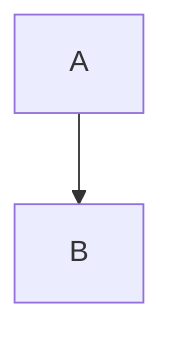

# Docs Site Reference

> Site mechanics for the MkDocs documentation site: diagrams, the lightbox and dependencies.
> **What goes on a page, and how it reads, is the documentation standard: read `engineering/DOCUMENTATION_STANDARD.md` before writing or changing any page under `docs/`.** For changelog format, see `engineering/CLAUDE.md`.

## Before you change a page

The standard is the authority; this is the short version of what trips people up.

- **Every page declares its type and audience** in front matter, alongside its `title` and `description` (STR-1, STR-2), and takes the shape its type requires (TYP-1). Quote any front matter value containing `: `; MkDocs silently drops a block it cannot parse.
- **When behaviour changes, rewrite what is now wrong; never append release history** ("previously", "now", "this release"). Search `docs/` for the sentence your change made false before you look for where to describe the new thing (MNT-1, MNT-2).
- **Product nouns come from the glossary.** Write them in Title Case (LANG-3); a new one needs a glossary entry and an entry in `docs/.conformance/vocabulary.psd1` in the same change (TERM-1).
- **What the product has, the docs document** (COV-1 to COV-4, COV-6): a new cmdlet needs a heading on its `docs/powershell/` page, a new environment variable a row in a settings table, a new Service Setting a row in the Service Settings table of `docs/administration/configuration.md`, a new Connector setting a row in a Setting table on its Connector's page (named exactly as the form shows it), a new expression function a row in the function reference, a new API controller a row in the Resource groups table on `docs/api/index.md`, and a removed one comes out of the docs. `Test-DocsCoverage.ps1` checks most of them, every link from the product into the docs (LNK-3), and the docs page every portal page names from its `PageInfo` (COV-5), on every pull request, so renaming a heading a portal page links to fails until the page is updated; the NUnit tests in `test/JIM.Worker.Tests/Docs/` check the settings. A deliberate exception goes in `docs/.conformance/coverage.psd1` with its reason.
- **A tutorial is executed every release, from the page** (TUT-1, TUT-2): its PowerShell tabs run in order, and its `<!-- checkpoint: ... -->` markers are asserted. Changing a tutorial's steps or what it says the reader sees is changing a test: keep each marker beside the sentence it checks, and name portal controls in bold exactly as the portal labels them. The standard's "Writing a tutorial" has the markers.
- **A priority page records the release it was last checked against** (`validated: vX.Y.Z`, PRI-1), and `/release` re-validates each one due. A change to a priority page does not touch its `validated:`; only reading the whole page against the product as a release ships it does.
- **A cmdlet's Syntax, Parameters and Output on a `docs/powershell/` page are generated from the module** between `<!-- BEGIN GENERATED -->` markers (ACC-5). Never edit inside them: change the cmdlet's help or `[OutputType]` and run `scripts/Update-PowerShellReference.ps1`, as `src/JIM.PowerShell/CLAUDE.md` describes. The introduction, examples and notes around them are written by hand.
- **A property an example reads from a JIM cmdlet's output must be one it returns** (ACC-6): `Select-Object Name`, `$_.Name` and `$widget.Name` are checked against the parameter set the example binds, by `Lint-DocExamples.ps1 -OpenApiPath` in `build-and-test`. A property that does not exist prints nothing, so a reader who copies the example gets blank output.
- **Write REST routes in full** (`/api/v1/synchronisation/connected-systems/{id}`), as the API reference names them, never abbreviated (ACC-3). `build-and-test` checks every route a page gives against the OpenAPI document, and the method given with it.
- **A page over 5,000 words must not grow** (MNT-3; a warning until the over-budget pages are split, then blocking): split it, or make room by rewriting what your change superseded.
- **`changelog-lint` checks the mechanical rules on every pull request,** and each failure names its rule ID. If your change removes existing debt (adding front matter to a page, say), the conformance check fails until you lock the improvement in:

    ```bash
    pwsh ./scripts/Test-DocsConformance.ps1 -UpdateBaseline
    ```

- **A rule that is wrong for one place is excused in that place,** with a reason: `<!-- conformance: allow STR-5 "terminal output, not code" -->`. Never edit the baseline by hand to make room.
- **The judgement rules get a rubric review** (`docs-review.yml`): one review thread per finding, citing its rule ID, and a summary comment posted last, when a pull request changing customer pages opens or is marked ready. Add the `docs-review` label for a fresh one after more commits; it raises nothing twice. The merge, auto-merge included, waits until every thread is resolved: fix the text, or reply with why it stays, then resolve the thread.

## ASCII Diagrams

When creating ASCII diagrams in documentation or code comments, use only reliably monospaced characters:

| Use         | Instead of    | Purpose                        |
|-------------|---------------|--------------------------------|
| `->` `-->`  | `->` `-->` `>` | Arrows (horizontal)           |
| `<-` `<--`  | special chars | Arrows (reverse)               |
| `v` / `^`   | `v` `^`       | Arrows (vertical)             |
| `+`         | box-drawing chars | Corners and junctions      |
| `-` / `|`   | `=` special chars | Lines (horizontal/vertical)|
| `-`         | bullets       | Bullet points in diagrams      |

## Concept Diagrams (inline SVG)

Customer-level concept diagrams (e.g. the Concepts page hero) are **hand-authored SVGs**, stored under `docs/assets/diagrams/` and inlined into the page via pymdownx.snippets:

```markdown
--8<-- "assets/diagrams/hub-and-spoke.svg"
```

Because the SVG is inlined (not loaded via ``), the page's CSS themes it: **one SVG serves both light and dark mode**, and text renders in the page's IBM Plex Sans webfont.

Authoring rules:

- **No colour literals in the SVG.** Shapes and text carry `.jimdg-*` classes; all colours live as `--jimdg-*` custom properties in `custom.css` ("Concept diagrams" section), with light and dark values per `[data-md-color-scheme]`. The visual language (tokens, geometry, rules) is defined in `engineering/DESIGN.md` > Diagrams.
- **No blank lines inside the SVG file.** The snippet is inlined into markdown as a raw-HTML block; a blank line would end the block and the remainder would be parsed as markdown.
- Root element: `<svg class="jim-diagram" viewBox="..." role="img" aria-labelledby="...">` with a `<title>` and descriptive `<desc>`.
- Arrowheads are explicit polygons, not `<marker>` elements (markers restyle unreliably across browsers).
- **Edge labels sit on their edge, with the edge cut away behind them.** Centre the label on its line and let the diagram's `<mask id="…-labelcut">` punch a hole in the edges, arrowheads and packets behind it. Never place an edge label by nudging it off the line by eye: a `<text>` `x`/`y` sits on the *baseline*, but the box that collides reaches about 11.6 user units above it, and on a diagonal the line travels sideways across that height, so a label that looks clear at the baseline is sliced at cap height. (That is exactly how eight touching labels shipped; every one was on a diagonal and none of the vertical ones were affected.) Full rule, and why a knockout stroke is the wrong mechanism here: `engineering/DESIGN.md` > Diagrams.
- **Never hand-write a cut rectangle; generate it.** Each one comes from the label's *rendered* metrics, so it cannot be reasoned about from the source. After moving, adding or rewording any edge label:

    ```bash
    pwsh -File ./scripts/Update-DiagramLabelCuts.ps1           # regenerate every diagram's cuts
    pwsh -File ./scripts/Update-DiagramLabelCuts.ps1 -Check    # verify; non-zero exit on drift
    ```

    `-Check` enforces that every edge label either fits its cut or stands at least 8 units clear of every edge, and separately that none crosses a node or boundary outline (which a cut cannot fix, because masking a `<rect>` holes its fill). It needs no setup: it drives the Chromium that `.devcontainer/setup.sh` already installs for the Playwright MCP server. Still eyeball the result in both themes afterwards.
- **A short edge keeps its label beside it.** If the cut would leave less than ~28 units of visible line, the label stays offset rather than erasing the edge it labels; the same goes for step captions that name a stage rather than hug an edge.
- **Keep boundary titles (`.jimdg-hub-title`) as the last element in the file.** Their knockout stroke only clears the edges underneath if the title paints after them, so the title belongs in a trailing `…-boundary-title` group rather than inside the boundary group next to its `<rect>`.
- Edge animation uses SMIL data packets (`<circle class="jimdg-packet">` with `animateMotion`), only on live edges, direction matching the arrowheads; `custom.css` hides `.jimdg-packet` under `prefers-reduced-motion`. Full motion rules: `engineering/DESIGN.md` > Diagrams.
- Follow the snippet include with a `<p class="jim-diagram-caption">` footnote decoding the visual encoding (illustrative examples, dashed = planned). Wrap any sentence that refers to the packet animation in `<span class="jimdg-caption-motion">`; it hides together with the dots under `prefers-reduced-motion`.
- No build step: the SVG is a static asset edited by hand; preview with `jim-docs` and verify in both themes.
- Inline SVGs are made click-to-enlarge by `diagram-zoom.js` (see "Diagram lightbox" below), not by GLightbox, which only wraps ``. Nothing per-diagram is needed: the script finds every `svg.jim-diagram`. Still size the composition to be legible at content-column width; the lightbox is for inspecting detail, not a substitute for a readable default.
- **README exports:** the GitHub README embeds self-contained light/dark copies of `system-context.svg` and `containers.svg` from `.github/diagrams/`. After changing either source (or the `--jimdg-*` tokens in `custom.css`), regenerate them with `pwsh ./scripts/Export-ReadmeDiagrams.ps1` and commit the results.

## Mermaid Diagrams

Write Mermaid diagrams inline in markdown as normal fenced code blocks. Every one carries an `accTitle` and an `accDescr` (A11Y-1 in the standard; the conformance check fails without them), so a screen reader gets what the picture shows:

````markdown

````

Nothing else is needed. They are clickable automatically (see "Diagram lightbox" below).

## Diagram lightbox

`docs/assets/javascripts/diagram-zoom.js` makes **both** diagram families click-to-enlarge in one overlay with zoom and pan; styling lives in the "Diagram lightbox" section of `custom.css`. No per-diagram markup is needed. No external dependencies: it uses only the Mermaid instance MkDocs Material already loads.

The script wraps each diagram in a `<button class="jim-dgz-trigger">` so it is keyboard-reachable, and adds a persistent "Enlarge" chip (a hover-only cue is invisible on touch). The overlay traps focus, restores it on close, and closes on backdrop click or Esc.

**Getting an SVG out of the page differs per family:**

| Family | How the overlay gets an SVG |
|--------|-----------------------------|
| Concept SVGs (`svg.jim-diagram`) | Inlined by pymdownx.snippets, so the node is in the DOM and is cloned directly. |
| Mermaid | Material renders into a **closed Shadow DOM** (`attachShadow({mode:"closed"})`), so the rendered SVG is unreachable via `querySelector` or `shadowRoot`. The script captures each diagram's source from `<pre class="mermaid">` *before* Material replaces it, pairs sources to shadow hosts by **insertion order**, and re-renders on click through the Mermaid API into a temporary off-screen node. |

**Three non-obvious behaviours worth keeping:**

- **100% is the whole diagram where that is worth having, and fit-to-*width* where it is not.** Fitting a tall Mermaid flowchart to viewport *height* renders it narrower than it already is in the page (measured: 1294px wide at fit-to-width versus 180px at fit-to-height), so those still open full width and pan vertically. But fit-to-width for *everything* was wrong for the concept SVGs, which are only slightly taller than the stage: a 1160x640 diagram on a 2.01-aspect stage opened with its bottom 10% quietly cut off, looking whole rather than looking panable. The opening view (`view.home`, and what 100% and Reset both mean) now contains the diagram unless containing would render it narrower than `MIN_CONTAIN_PX` (560) CSS pixels. **Measure that in pixels, not as a share of the stage.** A share gets the phone case wrong: on a 390px window the stage is tall and narrow, so containing a 4000-unit flowchart costs only 42% of the width, which sounds cheap and is actually a 153px sliver. By absolute width the two populations separate cleanly: on the worst desktop window (1440x620) the tallest concept diagrams contain to 674px and 755px, while a Mermaid flowchart contains to 98–182px on every window tested. Note that `clampView` is where the cap is actually enforced, so a change to the opening width has to be made in both places. `scripts/Test-DiagramLightbox.ps1` guards both halves of the rule and is wired into `changelog-lint`.
- **The visible window always carries the stage's aspect ratio**, so `preserveAspectRatio="xMidYMid meet"` never letterboxes and pointer coordinates map exactly. Zoom and pan are pure `viewBox` maths; there is no transform layer.
- **SMIL packets must be primed after any re-parenting.** A cloned or moved `<svg>` is its own timeline root and restarts at zero, which parks every packet with a positive `begin` offset at 0,0 - a dot stuck in the top-left corner for up to 1.2s. `primeAnimations()` winds the clock past the longest offset; it is called both when wrapping an in-page SVG in its trigger and when opening a clone. Removing either call brings the artefact back.

**Ids are rewritten on clone, not stripped.** Diagrams whose edge labels sit on the line point at a `<mask id="…-labelcut">` with `mask="url(#…)"`, so a stripped id leaves a dangling reference; a dangling mask reference renders *unmasked*, which would draw the lines straight through the labels in the overlay. `cloneForOverlay()` therefore suffixes every id and repoints every `url(#…)` and `href="#…"` that names one. Stripping happened to survive this at first, because the in-page copy was still in the document for the reference to land on; that stops being true the moment two diagrams share an id.

**If diagrams stop being clickable after a MkDocs Material upgrade:** check whether Material changed how it processes Mermaid. Look for changes to the `div.mermaid` shadow host insertion or `attachShadow` call (search for `attachShadow` in the bundle). The relevant function in the current bundle is named `Zn()`. Concept SVGs are unaffected by Material upgrades; they never enter a shadow root.

**Verifying changes:** Material loads Mermaid from `unpkg.com`, so Mermaid diagrams silently never render in an offline sandbox (the `<pre class="mermaid">` is consumed and nothing replaces it). To test that path, download the bundle once and intercept the CDN request in Playwright; otherwise you are only testing the concept-SVG half.

## GLightbox (image files)

GLightbox is configured as a plugin in `mkdocs.yml` and wraps all `` tags automatically. No per-image markup is needed. It handles raster images and any ``-referenced SVG; vector diagrams inlined in the page are handled by `diagram-zoom.js` instead.

The lightbox background is themed via `docs/assets/stylesheets/custom.css` (`.gslide-image img` rules) so transparent SVGs render against the correct surface colour in each theme.

## Dependencies

MkDocs dependencies are pinned in two places - keep them in sync:

| File | Purpose |
|------|---------|
| `.devcontainer/setup.sh` | Installed in the dev container |
| `.github/workflows/docs.yml` | Installed in CI for GitHub Pages deployment |
| `.github/workflows/changelog-lint.yml` | Installed in CI for the pull request docs site check |

Current pinned versions: `mkdocs>=1.6,<2`, `mkdocs-material>=9.7,<10`, `mkdocs-glightbox>=0.4,<1`.

The pull request link check also runs lychee, from its official container image pinned by digest in `scripts/Test-DocsSite.ps1` (row 10 of `engineering/DEPENDENCY_PINNING.md`).
