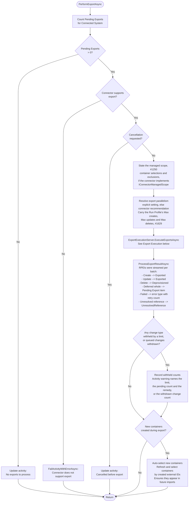
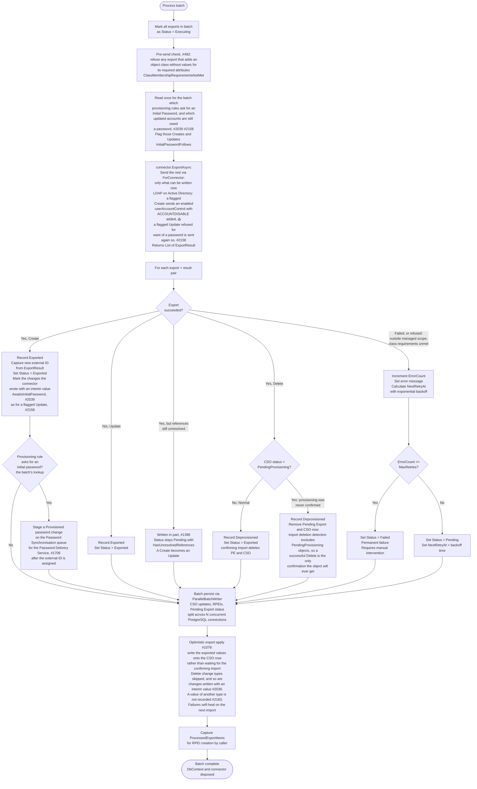
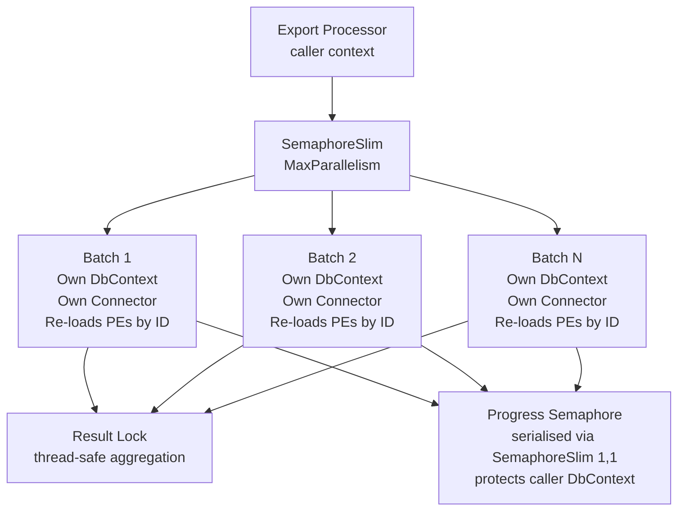

# Export Execution Flow

> Last updated: 2026-09-29, JIM v0.16.0

This diagram shows how Pending Exports are executed against Connected Systems via connectors. The export processor (`SyncExportTaskProcessor`) uses `ISyncServer` to delegate to `ExportExecutionServer` for the core execution logic, and `ISyncRepository` for bulk data access. Supports batching, parallelism, deferred reference resolution, retry with backoff, and per-Run Profile limits on how many creates, updates and deletes a run may send.

Since v0.10.0, connector exceptions thrown during export are always reported as RPEIs. The file-based outer catch in `ExportExecutionServer` and the call-based batch catches (immediate, sequential deferred and parallel) each create `ProcessedExportItems` for every export in the affected scope, naming its Pending Export and object. Previously, a thrown connector exception set `FailedCount` without creating RPEIs, so the activity could complete successfully despite silent export failures. Per-batch streaming via `batchCompletedCallback` keeps in-memory `ProcessedExportItem` accumulation bounded at 100K+ exports.

## Export Task Processing

## Export Execution (ExportExecutionServer)

```mermaid
flowchart TD
    Start([ExecuteExportsAsync]) --> Withdraw[Unless PreviewOnly: withdraw queued<br/>changes nothing authorises any more, #1885<br/>rule deleted or disabled, no enabled<br/>mapping, or CSO no longer joined<br/>Update PE left empty is deleted<br/>Executing PEs never touched]
    Withdraw --> GetExecutable[Establish whether there is executable work<br/>Database filter: Status, NextRetryAt, ErrorCount<br/>In-memory filter: has exportable attribute changes<br/>Delete exports already exported are skipped<br/>Creates already exported are skipped while<br/>they await confirmation, #1687<br/>The same filters drive the batch sweep below]
    GetExecutable --> HasExports{Exports<br/>found?}
    HasExports -->|No| EmptyResult([Return empty result])

    HasExports -->|Yes| CheckPreview{Run mode =<br/>PreviewOnly?}
    CheckPreview -->|Yes| PreviewResult[Return export IDs<br/>without executing]
    PreviewResult --> Done([Return result])

    CheckPreview -->|No| Limits{Run Profile has<br/>export limits?}
    Limits -->|Yes| Ledger[Count executable exports per change type<br/>ExportChangeLimitLedger withholds, in full,<br/>any type whose count exceeds its limit<br/>Withheld exports stay Pending, untouched]
    Limits -->|No| ConnectorType
    Ledger --> ConnectorType{Connector<br/>export type?}

    ConnectorType -->|IConnectorExportUsingCalls| PrepareConnector[Inject CertificateProvider<br/>and CredentialProtection]
    PrepareConnector --> OpenExport[OpenExportConnection<br/>with system settings]

    %% --- Batch collection: single forward keyset sweep ---
    OpenExport --> Collect[Collect next page of Pending Exports<br/>keyset cursor on CreatedAt, Id, #985<br/>never rescans from the start<br/>withheld change types excluded]
    Collect --> Empty{Page<br/>empty?}
    Empty -->|Yes| CaptureContainers
    Empty -->|No| SplitExports[Split the page into:<br/>- Immediate exports: no unresolved references<br/>- Deferred exports: have unresolved references]

    %% --- Immediate exports ---
    SplitExports --> HasImmediate{Immediate<br/>exports?}
    HasImmediate -->|Yes| ParallelCheck{MaxParallelism > 1<br/>and factories provided?}
    ParallelCheck -->|Yes| ParallelBatch[Process batches in parallel<br/>Each batch gets own:<br/>- DbContext<br/>- Connector instance<br/>both disposed as the batch completes, #1006<br/>Progress serialised via SemaphoreSlim<br/>LDAP concurrency auto-tuned:<br/>AD/OpenLDAP default 16,<br/>Samba/unknown default 4]
    ParallelCheck -->|No| SequentialBatch[Process batches sequentially<br/>Using existing connector + DbContext]

    ParallelBatch --> ClearTracker[ClearChangeTracker<br/>after each batch]
    SequentialBatch --> ClearTracker
    ClearTracker --> Collect

    %% --- All-deferred fast path ---
    HasImmediate -->|No, whole page deferred| Probe{Any executable<br/>non-deferred exports<br/>beyond the cursor?}
    Probe -->|Yes| Collect
    Probe -->|No| CollectRest[Fast path #985c:<br/>collect ALL remaining deferred<br/>exports in one query and<br/>stop the sweep]
    CollectRest --> CaptureContainers

    %% --- Deferred exports ---
    CaptureContainers[Capture created container<br/>external IDs from connector] --> HasDeferred{Deferred<br/>exports collected?}
    HasDeferred -->|Yes| BulkFetchRefs[Bulk pre-fetch all<br/>referenced CSOs by MVO IDs<br/>in single query]
    BulkFetchRefs --> ResolveRefs[For each deferred export:<br/>Try to resolve MVO references<br/>to target system CSO external IDs]
    ResolveRefs --> Resolved{References<br/>resolved?}
    Resolved -->|Yes| PersistRefs[Persist the resolutions BEFORE<br/>dispatching parallel batches, #994<br/>each batch loads its own copy and<br/>would otherwise export raw MVO IDs]
    PersistRefs --> ExportResolved[Batch export resolved<br/>exports same as immediate]
    Resolved -->|No| MarkDeferred[Mark as deferred<br/>Will be retried next run]

    HasDeferred -->|No| CloseExport
    ExportResolved --> CloseExport
    MarkDeferred --> CloseExport

    CloseExport[CloseExportConnection]
    CloseExport --> SecondPass[Second pass: retry references deferred<br/>by a PREVIOUS export run<br/>single indexed query on the<br/>unresolved-references partial index, #1102]
    SecondPass --> Done

    ConnectorType -->|IConnectorExportUsingFiles| FileExport[File-based export<br/>with batching<br/>reserved against the ledger<br/>before the file is written<br/>Exported values recorded on the CSO<br/>Auto-confirming connectors delete<br/>each Pending Export once recorded, #1936]
    FileExport --> Done
```

## Batch Execution Detail

Each batch follows this sequence, whether processed sequentially or in parallel:

## LDAP Export Consolidation and Chunking

For LDAP connectors, individual attribute changes are consolidated and chunked before being sent to the directory server. This ensures RFC 4511 compliance and prevents server rejection of oversized modify requests.

**Batch size** is configurable via the "Modify Batch Size" connector setting (default: 1000, clamped to 10-5000, recommended 100-2000). The default was raised from 100 because several directory servers' per-modification cost grows with the group's current membership size, so fewer, larger requests cut total export time by an order of magnitude for groups with tens of thousands of members. Newly created Connected Systems pick up the new default; existing ones keep their stored value, since connector settings are captured per system at creation.

## Parallel Batch Architecture

When `MaxParallelism > 1`, batches are distributed across concurrent tasks. Each task is fully isolated to avoid EF Core thread-safety issues.

- **Batch IDs are captured** before dispatching - each parallel task re-loads its exports from its own DbContext by ID
- **Progress reporting** is serialised via `SemaphoreSlim(1,1)` to protect the caller's shared DbContext
- **Result aggregation** uses a lock for thread-safe counter updates
- **Connector instances** are created per-batch via factory to avoid shared connection state

## Key Design Decisions

- **Two-pass export**  Exports without unresolved references are executed first (immediate). Exports with unresolved MVO references are deferred, with references bulk-resolved in a single query, then executed in a second pass.

- **Run Profile export limits (#1618, #1629)**  An Export Run Profile may carry Max creates, Max updates and Max deletes. When any is set, the executable Pending Exports are counted per change type once at the start of the run, and `ExportChangeLimitLedger` withholds in full any type whose count exceeds its limit: never a head of the queue, so a frequent Schedule cannot trickle a wrong mass change through. Withheld exports stay `Pending` and untouched (not marked, not failed, given no RPEI), withheld types are excluded from the paging query, and one ledger is shared by both passes and both connector shapes. The Activity records the withheld counts and completes with a warning naming the limit and the remedy. An uncapped run does no extra database work.

- **An exported Create is never re-sent while it awaits confirmation (#1687)**  A Create at `Exported` is filtered out of the executable set: re-sending it would ask the connector to create an object that already exists. Changes staged while it waits are appended to it as `Pending` attribute changes, and travel as one Update once the confirming import confirms the object and reconciliation turns the Create into an Update (see [Pending Export Lifecycle](PENDING_EXPORT_LIFECYCLE.md)). A Create at `ExportNotConfirmed` is still exportable, because it genuinely needs to go again.

- **Refusals JIM makes before, or instead of, the target system (#492, #1250)**  Two refusals give an administrator an actionable error rather than whatever the target system would return. Before a batch is sent, any export that adds an object class without values for that class's required attributes is failed as `ClassMembershipRequirementsNotMet`, naming the attributes. During the export, a connector given a managed scope refuses per object any write outside the selected containers, so an Attribute Flow cannot move an object somewhere JIM could not read it back. Both take the ordinary failure path, and the rest of the batch proceeds.

- **Initial passwords are staged, not delivered (#1121, #1706)**  When a Create succeeds for an object whose provisioning Synchronisation Rule asks for an initial password, the export records a Provisioned password change on the Password Synchronisation queue, after the external ID has been assigned so the object can be addressed. The Password Delivery Service delivers it later over the connector's password channel; setting it inside the export would put a second network call in the loop persisting a write that has already succeeded. A staging failure is logged as an error and counted on the Activity, never turned into a failed export. The Create's Pending Export is written only after staging (#2270), so a password change waiting on the account (which waits while its Create is `Executing`, #2160) is still there for staging to find rather than delivered and removed first; a failure in between still writes it. Where the queue already holds a change for the person and system, one statement decides (#2160): a live change that will reach the account (a propagated change for the targeted Object Type, or an administrator's set naming it) carries the account's first password instead, keeping its own password and taking the obligation (`ProvisionedConnectedSystemObjectId`, `SyncRuleId`, the mark), so its delivery applies the rule's Enable Account and "Password never expires"; any other row is replaced (dead, parked beyond cure, held by a paused system, for another Object Type, an administrator's set whose account is gone or disjoined, an earlier Initial Password), since a person has one joined Connected System Object per Connected System and such a row cannot reach any of theirs there. Every outcome gets a staging Activity.

- **The connector is told a password will follow (#2039, #2158)**  Two lookups, each made at most once per batch, before the batch is sent rather than after it succeeds, on the immediate, sequential-deferred and parallel paths alike (the parallel path on the batch's own repository, against the exports it re-loaded), and both setting the transient `InitialPasswordFollows` flag. A Create is flagged when its provisioning Synchronisation Rule asks for an Initial Password, and staging reuses the same answer, so the lookup moved rather than multiplied. The predicate is the rule's Initial Password being enabled, not its EnableAccount option: the delivery completes an enable JIM withheld whatever EnableAccount says (`AccountFlagsPolicy`, #2064), so the confirming import confirms the flow's value. An Update is flagged when its account's Metaverse Object is still owed a password on the Connected System (Pending, Delivering or Parked, any origin), the confirming import's own hold test (`GetMetaverseObjectIdsOwedPasswordAsync`); the lookup runs only for a batch holding an Update to a joined account, through a connector that implements `IConnectorPasswordManagement`. A failed rule lookup flags no Create and is reported through staging; a failed owed lookup flags no Update and is logged as a Warning naming the Connected System.

- **The update resend (#2158)**  A flagged Update is sent as the flow asks. Only when the directory refuses it as an account-enable refusal (`LdapAccountEnableRefusalClassifier.IsAccountEnableRefusal`, `0000052D` on the Active Directory family) and the refused request carries exactly one `userAccountControl` modification, a Replace of a single integer without ACCOUNTDISABLE, does the LDAP Connector send the same modifications again with ACCOUNTDISABLE added, through the same `SendModify`/`SendModifyAsync` path (so Permissive Modify and the fallback in parts apply), on the sequential and concurrent paths, after a rename without repeating it. It reports `userAccountControl` in `AttributesAwaitingInitialPassword`, and from there the hold, the delivery's completion and the confirming import work exactly as for a Create. Reactive rather than proactive, so an account that already has a password, or a directory that never refuses (Samba AD today, or a domain whose policy allows an empty password), is enabled at once. A resend refused again fails with the original classification. The modify Active Directory refused applied nothing, so resending the whole request is safe even where the refusal came from one step of the fallback in parts.
- **The create rewrite (#2039)**  Active Directory refuses an enabled account with no password (`0000052D`). In `BuildAddRequestWithOverflow`, the LDAP Connector adds ACCOUNTDISABLE (`0x2`) to the `userAccountControl` value an add carries when the directory is real Active Directory (`LdapDirectoryType.ActiveDirectory`, not the whole Active Directory family, so Samba AD is unchanged), the export is a Create flagged `InitialPasswordFollows`, and the value is a single integer without the flag: `512` is sent as `514`. Only the request's copy changes; the Pending Export keeps the flow's value, because that is what the confirming import is judged against and connectors never mutate an export. The connector names the attribute in `ConnectedSystemExportResult.AttributesAwaitingInitialPassword`, and `ProcessBatchSuccessAsync` marks each written change it names with the persisted `AwaitsInitialPassword` (clearing it on every other written change; a report on an unflagged export is a connector defect, logged as an error and ignored). The change stays `ExportedPendingConfirmation`, so every in-flight protection applies unchanged. Without an Initial Password, the refusal is classified as `PasswordRequiredToEnableAccount` with the remedies named, rather than an unhandled error.

- **The hold (#2039)**  Every import of the Connected System judges every marked change, whether or not it returns the account. Reconciliation judges the changes on the objects the import returned, against the flow's value: when it matches, the change confirms as usual. When it does not and a password is still owed to the account (a password change for its Connected System and Metaverse Object that is Pending, Delivering or Parked, of any origin), the change is **held**: unchanged, not retried, no RPEI, counted in the reconciliation summary, and the Pending Export keeps its status, so nothing is sent. Once no password is owed (delivered with an administrator's explicit choice not to enable the account, expired, cancelled, never staged, or no Metaverse Object), it is **released**: back to `Pending` with the flag cleared, silently, so the next export writes the flow's value as an ordinary Update, which fails with the actionable error if the account still has no password. An expired or cancelled password, or one delivered with an explicit choice not to enable the account, usually changes nothing an import reads, so the account is not returned at all: a Full Import skips it by its content hash (the confirming import stamped the disabled state) and a Delta Import has nothing to report. After reconciliation, `SyncImportTaskProcessor.JudgeUnreconciledInitialPasswordHoldsAsync` therefore judges every marked change on an object the import did not reconcile, on Full and Delta Imports alike: one set-based query per run (`ISyncRepository.GetInitialPasswordHoldSummariesAsync`, led by the partial index on the flag, so a system with nothing held pays an empty index probe and nothing more), one owed-password lookup for all of them, and a Pending Export load only for the objects to release. Released exactly as reconciliation releases, and it touches nothing else on those objects: their imported values may predate the export, so no other change is confirmed or retried. A Create no import has confirmed keeps its status, because confirming is what turns it into an Update; its released change goes out once an import confirms it. The run logs a summary of held and released counts. Four guards keep a held change honest: Drift Detection skips its Connected System Object entirely, in the run and in the synchronisation preview, because a correction on any attribute would make the page flush replace the whole Pending Export; export evaluation drops an incoming change restating exactly what a held change asserts, in every merge branch, while a different value still supersedes it, and where nothing else changes the persisted Pending Export is kept rather than rebuilt (anything the target no longer needs is withdrawn from it in place, and nothing else about it changes, including the item that queued it), which the synchronisation preview mirrors by dropping the same restatements before it proposes an export, while the configuration change preview keeps them as the saved configuration's side of the attribute's old-to-new pair; a held change is withdrawn like any queued change when the evaluation finds the target already holds what the Metaverse Object now wants (the leaver during the hold: the rule now yields the disabled value the account was created with, and the held enabled value, kept, would be released and enable the account), unless that already-current answer restates exactly what it asserts; and optimistic apply does not record the asserted value, since the Connector wrote an interim one, so the attribute records nothing until the confirming import reports what the target holds. Every path but the per-import held-set query is inert unless a change carries the flag. See [Pending Export Lifecycle](PENDING_EXPORT_LIFECYCLE.md).

- **The enabled state an export wrote (#2064)**  On a successful export the Connector reports whether it wrote the attribute through which the account is enabled or disabled (`ConnectedSystemExportResult.SetsAccountEnabledState`; the LDAP Connector reports it on the Active Directory family for a Create's add, an Update's modify or a Delete performed as a disable that writes `userAccountControl`). `ProcessBatchSuccessAsync` stamps it on a Create's staged Provisioned password, and marks any first password still owed to another account it was reported for (its Provisioned row, or a change carrying the first password in its place, #2160), whatever its status, in one status-mark UPDATE, written first, straight from the Connector's results and before anything in result processing that can throw (#2173): the delivery waits while an account's export is in flight, so the mark must already be in place when the batch's Pending Exports leave `Executing`. The Password Delivery Service reads the mark afresh at each attempt and leaves that account's enabled state and "Password never expires" to the Attribute Flow (`AccountFlagsPolicy`, #2159), so an account the flow creates or sets disabled is never enabled by its Initial Password, and a flow's `0x10000` is never cleared by its expiry. A marking failure is logged with the accounts, counted (`InitialPasswordMarkingFailedCount`) and put on the export Activity as a warning, never failing the export.

- **Keyset batch collection (#985)**  Batches are collected in a single forward sweep with a keyset cursor on `(CreatedAt, Id)`. Executed exports drop out of the query mid-run and deferred ones stay `Pending` while being accumulated in memory, so a strictly-increasing cursor never re-reads a row. The previous OFFSET implementation restarted its scan from zero for every batch and degraded to O(n²) page loads once thousands of deferred exports accumulated; at 200,000 objects with 10,000 reference-bearing groups it spent hours re-reading collected rows before the first group reached the target system. Known trade-off: an export whose `NextRetryAt` backoff elapses mid-run at a position already behind the cursor waits for the next export run.

- **All-deferred fast path (#985c)**  When an entire collected page turns out to be deferred, `AnyExecutableNonDeferredExportsAfterAsync` probes for executable exports beyond the cursor; if there are none, `GetRemainingDeferredExportsAsync` collects the rest in one set-based query and the sweep stops. The probe is mandatory: deferred and executable exports interleave in `(CreatedAt, Id)` order, so a full deferred page does not prove the remainder of the queue is deferred, and breaking out without it would silently skip executable exports created after a contiguous deferred run.

- **Partial writes for unresolved references (#1398)**  A deferred export whose references still cannot all be resolved after the bulk pre-fetch is not held back whole. Its writable changes (everything but the reference values still owed) are handed to the connector alongside the resolved exports; on success the export stays `Pending` with `HasUnresolvedReferences`, its `ChangeType` flips from Create to Update (the row now exists, so it must never be inserted again), and only the reference changes remain for the deferred cadence. The connector always receives the export through `ForConnector`, a view carrying only what can be written now, on the immediate, sequential-deferred and parallel paths alike; the parallel path re-loads from persisted state, which is why the split is derivable from the persisted rows. Unresolved references are classified against the pre-fetched lookup: a referenced Metaverse Object with a Connected System Object but no anchor is waiting and reported nowhere; one with no Connected System Object in the target is unresolvable and reported per the Connected System's `UnresolvedReferenceHandling` (Error: an `UnresolvedReference` error on the referrer's RPEI, or on a `PendingExport`-type RPEI when nothing was written; Warn: a summary count on the Activity; Ignore: log only). Reconciliation on the confirming import confirms the written half of a still-`Pending` export.

- **SQL-filtered second pass (#1102)**  `ExecuteDeferredReferencesAsync` retries references deferred by a *previous* export run. It filters in SQL against a partial index on unresolved references. It previously loaded and hydrated the Connected System's entire Pending Export set, including every attribute value change, then filtered client-side for the usually-zero unresolved rows; at 525,000 Pending Exports that cost around 11 minutes per run even when there was nothing to resolve.

- **Reference resolutions persisted before parallel dispatch (#994)**  Deferred references are resolved in the caller's context, but each parallel batch re-loads its exports from its own `DbContext`. The resolutions are therefore persisted before the batches are dispatched; without that, batches saw the pre-resolution values and sent raw internal identifiers to the target system (an LDAP directory rejects these as "invalid per syntax").

- **Optimistic export apply (#1079)**  After a successful call-based export, the exported values are written straight onto the CSO instead of waiting for the confirming import to re-materialise them from the target system. This collapses the confirming import's write volume (measured: 524,997 exported CSOs previously re-materialised 9.8 million attribute values) and re-arms Full Synchronisation's unchanged-object fast path a run sooner. Delete change types are skipped (the CSO is being removed), and so is a change the connector wrote with an interim value until an Initial Password is delivered (#2039), whose asserted value the target does not hold; any apply failure is safe: the next confirming import self-heals it. A change whose value is held in another data type's column than its attribute's (only a fault elsewhere produces one, since export staging converts expression results to the attribute's type, #2179; #2183) is not recorded either: an Update still removes the values it replaced, and the change is reported as unrecorded and logged at Warning. File-based exports apply too (#1936), and there an auto-confirmed export whose values cannot be recorded, whether the recording failed or the export carries such a change, is left `ExportNotConfirmed` to be sent again, because no import follows it. Applied counts are logged as a summary at the end of every export run.

- **Per-batch resource release (#1006)**  Each parallel batch's `DbContext` and connector are disposed as that batch completes. They were previously held for the remainder of the run, so a large reference-heavy export drained the connection pool after around 29 batches and failed with "the connection pool has been exhausted".

- **Queued changes withdrawn once nothing authorises them (#1885)**  Before anything is counted or sent (and never in a preview), `WithdrawQueuedChangesWithoutAuthorityAsync` withdraws each queued change (`Pending` or `ExportedNotConfirmed`) on an Update Pending Export whose export Synchronisation Rule is deleted or disabled, no longer has an enabled Attribute Flow for the attribute, or whose CSO is no longer joined; `ISyncEngine.SelectQueuedChangesWithoutAuthority` makes the decision, and an Update left empty is deleted. The same withdrawal runs as each export-relevant configuration change is saved; the export-time run is the backstop, and the only one that sees a join broken by scope exit. The Activity carries a warning with the counts, since a change an administrator may have expected did not go out. Creates, Deletes, unattributed changes, changes already sent and `Executing` Pending Exports are left alone.

- **An interrupted batch never stays `Executing` (#2083)**  `MarkBatchAsExecutingAsync` snapshots each export's retry state (`PendingExportRetryState`) before the mark. On every call-based path (immediate, sequential deferred and parallel), a run cancelled while the Connector holds a batch puts it back to that snapshot (`ReleaseBatchAfterCancellationAsync`), with no attempt counted, and a batch that fails as a whole, including an `OperationCanceledException` nobody asked for such as an HTTP timeout, records one failed attempt per export with an RPEI naming its object (`RecordBatchFailureAsync`). A cancellation stops the run at the next batch boundary; a failed first-pass batch ends the first pass (the deferred pass still runs), a failed sequential deferred batch ends that pass, and a failed parallel batch leaves the other batches running. Both writes go through `ReleaseExecutingPendingExportsAsync`, which writes only rows still `Executing`, so a result already recorded is never overwritten; `UpdatePendingExportsAsync` writes a Pending Export and its attribute changes in one transaction, so a row that has left `Executing` is wholly recorded. The parallel path does this on the batch's own repository while its scope is alive, and a failure closing a batch's connector after its outcome is recorded is reported once, beside it. Results the Connector returned are lost only when processing them fails before they are persisted (Collision Remediation failing part-way, say): the batch is then recorded as failed, so a Create it had written is sent again. A Connector that stops on cancellation reports what it never started as `ConnectedSystemExportResult.NotAttempted()`: `ProcessBatchSuccessAsync` puts those back first, uncounted and with no RPEI, and records the rest; a not-attempted result while the run is not cancelled is a failed attempt, logged as an Error. The SQL and SCIM Connectors give a write already under way 30 seconds after the cancellation (`InFlightCancellation`), then abandon it and report it failed. When a run stops early, `HandOnProcessedExportItemsAsync` hands on the execution items already gathered, so a deferred pass's completed batches are recorded.

- **Executing recovered at worker start**  A Pending Export left `Executing` by a worker crash or restart, or by the release write itself failing (logged as an Error naming the rows), is recovered when the worker starts (`RecoverStrandedExecutingPendingExportsAsync`): to `Exported` if any of its changes was already sent, so the next confirming import reconciles it, otherwise to `Pending`, so the next export retries it.

- **Retry with backoff**  Failed exports are retried with exponential backoff via `NextRetryAt`: a call-based failure returns the export to `Pending`, and a file-based export that throws marks the whole file's exports `ExportNotConfirmed` with the same backoff. After `MaxRetries` attempts, the export is marked as permanently `Failed`.

- **No-net-change detection**  Before exports are created during sync, the system checks if the target CSO already has the expected values. This happens upstream in `EvaluateExportRulesWithNoNetChangeDetectionAsync`, not during export execution. An attribute found already current there also withdraws any change still queued for it (#1883); see [Pending Export Lifecycle](PENDING_EXPORT_LIFECYCLE.md).

- **Container auto-selection**  When exports create new containers (e.g., OUs in LDAP), their external IDs are captured and auto-selected so they appear in future imports without manual configuration.

- **Preview mode**  `SyncRunMode.PreviewOnly` returns the list of exports that would be processed without executing them, enabling dry-run functionality.

- **Per-batch isolation**  Each parallel batch gets its own `DbContext` and connector instance. EF Core is not thread-safe, so sharing a context across batches would cause data corruption.

- **ParallelBatchWriter (#394)**  The persistence phase of each batch (CSO updates, RPEI persistence, Pending Export status updates) is split across N concurrent PostgreSQL connections via `ParallelBatchWriter`. This parallelises the bulk database writes that were previously sequential, significantly reducing batch persistence time.

- **LDAP consolidation**  Multiple changes to the same attribute with the same operation type (e.g., 200 individual "member Add" operations) are consolidated into a single `DirectoryAttributeModification` before sending to the directory server. This is the correct RFC 4511 pattern and dramatically reduces the number of LDAP modify requests.

- **LDAP chunking**  Consolidated modifications that exceed the configurable batch size (default: 1000) are split into multiple `ModifyRequest` objects sent sequentially. This prevents LDAP server rejection of oversized requests, which is important for large group membership changes.

- **Connector-recommended export parallelism**  When a Connected System has no explicit Max Export Parallelism, the degree of parallelism now comes from the connector's recommendation rather than defaulting to sequential. The LDAP Connector recommends two parallel batch pipelines for directories tuned to a high Export Concurrency and stays sequential otherwise. An explicitly configured value always wins.

- **LDAP export concurrency auto-tuning**  Export concurrency defaults are automatically tuned based on the detected directory server type. AD and OpenLDAP directories default to 16 concurrent export operations, while Samba and unknown directory types default to 4. This balances throughput against server stability; Samba's LDAP implementation is less tolerant of high concurrency.
