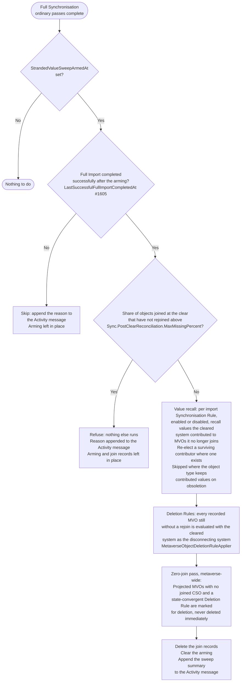

# Full Synchronisation - CSO Processing Flow

> Last updated: 2026-11-11, JIM v0.17.0

This diagram shows the core decision tree for processing a single Connected System Object (CSO) during Full or Delta Synchronisation. This is the central flow of JIM's identity management engine.

Both Full Sync and Delta Sync use identical processing logic per-CSO. The only difference is CSO selection:
- **Full Sync**: processes ALL CSOs in the Connected System, every run, whether or not they changed (#891). It does not read `LastSyncCompletedAt` or any mark to decide what to process, so it is the backstop for anything a Delta Sync missed
- **Delta Sync**: processes only CSOs marked `SynchronisationPending` (#2092), `DerivedInputChangePending` (#1750) or `ScopeReviewPending` (#892), or created or updated since `LastSyncCompletedAt`; see [Delta Sync Flow](DELTA_SYNC_FLOW.md)

Both page the Connector Space one Object Type at a time, in dependency order (#2492): referenced types first, so a group's members have been projected by the time its page is processed and its member references resolve in the page loop rather than in the cross-page reference step.

A Run Profile's partition (#353) scopes imports and their deletion detection only; synchronisation always works across the whole Connector Space.

Since v0.7.1, sync decisions are split across three layers:
- **ISyncEngine:** Pure domain logic (projection, Attribute Flow, deletion rules, export confirmation). Stateless, I/O-free.
- **ISyncServer:** Orchestration facade (matching, scoping, drift detection, export evaluation). Delegates to application-layer servers.
- **ISyncRepository:** Dedicated data access (bulk CSO/MVO writes, Pending Exports, RPEIs).

## Overall Page Processing

```mermaid
flowchart TD
    Start([Start Sync]) --> Prepare[Prepare: count CSOs, the progress estimate only<br/>Load Synchronisation Rules, object types via ISyncRepository<br/>Build the derived flow graph #1750:<br/>a cycle fails the run before any object<br/>Build drift detection cache<br/>Build export evaluation cache: export rules to<br/>every Connected System, this one included #1284<br/>Prepare Unique Value Generation #242<br/>Order the Object Types in use by dependency #2492]
    Prepare --> PageLoop{More CSO<br/>pages?}

    PageLoop -->|Yes| LoadPage[Load the next page of CSOs<br/>one Object Type at a time, referenced<br/>types first #2492, each with its own<br/>keyset cursor on Id #1858, paged until<br/>a page comes back empty #2092, then<br/>a closing sweep of objects created<br/>mid-run behind a type already walked<br/>Capture each marked row's xmin<br/>Prefetch generated value assignments<br/>Seed page identity map #1612 with<br/>the page's joined MVOs]
    LoadPage --> CsoLoop{More CSOs<br/>in page?}

    CsoLoop -->|Yes| CheckCancel{Cancellation<br/>requested?}
    CheckCancel -->|Yes| FlushBeforeCancel[Complete current page flush<br/>before stopping]
    FlushBeforeCancel --> Return([Return - activity<br/>finalised by caller])
    CheckCancel -->|No| Pass1[Pass 1: for every CSO in page<br/>ProcessObsoleteConnectedSystemObjectTeardownAsync<br/>- Tear down obsolete CSOs<br/>- Populate _pendingDisconnectedMvoIds]
    Pass1 --> PrefetchJoins[PrefetchJoinMatchesForPageAsync #2020:<br/>for every unjoined CSO, walk its Object<br/>Matching Rules in Order a round at a time,<br/>one lookup per lookup key per round,<br/>then load the settled MVOs and read<br/>their join counts, once per page]
    PrefetchJoins --> Pass2[Pass 2: for every non-obsolete CSO<br/>ProcessActiveConnectedSystemObjectAsync<br/>See Per-CSO Processing below]
    Pass2 --> IncrProgress[Increment ObjectsProcessed]
    IncrProgress --> CsoLoop

    CsoLoop -->|No| DeferredRef[Process deferred reference attributes<br/>Second pass: resolve MVO references<br/>that depend on other CSOs in page]
    DeferredRef --> PersistMvo[PersistPendingMetaverseObjectsAsync:<br/>bulk persist MVO creates + updates<br/>Flush the marks: one guarded clear,<br/>held-back objects kept marked #2343,<br/>then the scope flags cleared]
    PersistMvo --> GeneratedValues[Delete generated value assignments<br/>that no longer belong, then commit<br/>the page's new ones #242]
    GeneratedValues --> CreateMvoChanges[CreatePendingMvoChangeObjectsAsync:<br/>build in-memory MVO change records<br/>for audit trail]
    CreateMvoChanges --> EvalDrift[EvaluateQueuedDriftAsync:<br/>drift detection for queued CSOs,<br/>now that MVOs have real ids]
    EvalDrift --> EvalExports[EvaluatePendingExportsAsync:<br/>refresh the page's export cache,<br/>prefetch export matching candidates<br/>once per Object Matching Rule group,<br/>then evaluate outbound exports<br/>for each tracked MVO]
    EvalExports --> FlushPE[FlushPendingExportOperationsAsync:<br/>create/delete/update Pending Exports]
    FlushPE --> ResolveSnapshots[ResolvePendingExportReferenceSnapshotsAsync:<br/>fix up reference attribute snapshots<br/>on newly-created Pending Exports]
    ResolveSnapshots --> FlushCSO[FlushObsoleteCsoOperationsAsync:<br/>persist queued CSO deletions]
    FlushCSO --> FlushMVO[FlushPendingMvoDeletionsAsync:<br/>0-grace-period MVO deletions<br/>See MVO Deletion and Grace Period]
    FlushMVO --> FlushHistory[FlushPageHistoryAsync #2874 #2924:<br/>prepare the page's history: RPEIs, outcomes,<br/>CSO and MVO change records, causal edges,<br/>match candidates, every id assigned<br/>Release the RPEIs from the Activity and<br/>the change tracker, look up the CSOs its<br/>change values refer to, then wait for the<br/>previous page's history write and hand the<br/>batch to the run's history writer, which<br/>writes it in one transaction on its own<br/>connection while the next page loads, is<br/>processed and saves its changes<br/>A failed write stops the run, naming its<br/>page, once this page's history is written]
    FlushHistory --> ClearCache[Clear export evaluation cache,<br/>change tracker and page identity map<br/>together at page boundary]
    ClearCache --> UpdateProgress[Update activity progress<br/>in database]
    UpdateProgress --> PageLoop

    PageLoop -->|No| WaitLastHistory[WaitForPageLoopHistoryAsync #2874:<br/>wait for the last page's history write,<br/>on cancellation too]
    WaitLastHistory --> CrossPage[Cross-page reference resolution<br/>Reload CSOs with unresolved references<br/>in batches of at most a page of objects<br/>and 100,000 reference values #2492<br/>progress counted in reference values<br/>Resolve MVO references across pages<br/>Merge new attribute-flow rows under<br/>the existing MvoChange parent RPEI<br/>Re-run persist/flush pipeline]
    CrossPage --> DeferredRecall[FlushDeferredRecallRpeisAsync:<br/>one RPEI per referencing CSO whose<br/>reference-recall Pending Export was staged]
    DeferredRecall --> ScopeReview[ProcessScopeReviewPendingMetaverseObjectsAsync:<br/>re-evaluate export scope for flagged MVOs:<br/>the Temporal Scope Reconciler's #892, an<br/>export rule configuration change's #1925 and a<br/>write outside synchronisation's #2615, whose<br/>recorded changed and removed values are<br/>delivered to existing accounts too<br/>First clears the flags of types no enabled<br/>export rule covers, without loading them<br/>Batches of 500, change detection off as in the<br/>page flush; the clear keeps the flags and<br/>stops if an export rule changed since this run<br/>read its rules, and keeps any object written<br/>since it was loaded (row version), for the<br/>next run to review<br/>Keeps an execution item, named after the MVO,<br/>only for an object export evaluation changed]
    ScopeReview --> Revisions[ProcessGeneratedValueRevisionsPendingAsync #242:<br/>carry generated values an export run<br/>corrected to the queued exports<br/>Return undrawn sequence numbers #2044]
    Revisions --> Watermark[Update delta sync watermark<br/>LastSyncCompletedAt = UtcNow<br/>Skipped, with every step after the<br/>page loop, when the run is cancelled]
    Watermark --> Sweep{Full Sync, and armed by<br/>a Connector Space clear?}
    Sweep -->|No| End([Sync Complete])
    Sweep -->|Yes| StrandedSweep[Stranded-value sweep #1549 #1605<br/>See Stranded-Value Sweep below]
    StrandedSweep --> End
```

## Per-CSO Processing

This is the decision tree for a single CSO, spanning Pass 1 (`ProcessObsoleteConnectedSystemObjectTeardownAsync`, whose obsolete path is `ConnectedSystemObjectObsoletionService`) and Pass 2 (`ProcessActiveConnectedSystemObjectAsync`).

```mermaid
flowchart TD
    Entry([Process one CSO]) --> CheckObsolete{CSO status<br/>= Obsolete?}

    %% --- Obsolete CSO path ---
    CheckObsolete -->|Yes| CheckJoined{CSO joined<br/>to MVO?}
    CheckJoined -->|No, NotJoined| QuietDelete[Delete CSO quietly<br/>Already disconnected]
    CheckJoined -->|No, other JoinType| DeleteOrphan[Create Deleted RPEI<br/>Queue CSO for deletion]
    CheckJoined -->|Yes| CheckOosAction{ISyncEngine.DetermineOutOfScopeAction<br/>InboundOutOfScope<br/>Action?}

    CheckOosAction -->|RemainJoined| KeepJoin[Delete CSO but preserve<br/>MVO join state<br/>Once managed always managed<br/>An export rule provisioning here flags<br/>the MVO for export scope review #2318]
    CheckOosAction -->|Disconnect| SurvivorScope{Recall enabled, and a<br/>surviving contributor's scope<br/>cannot be decided? #2336}
    SurvivorScope -->|Yes| HeldBack[Held back: RPEI ScopingCriterionFailed<br/>CSO and MVO left exactly as they were<br/>kept marked so the next run,<br/>Delta included, retries #2343]
    SurvivorScope -->|No| RemoveAttrs{RemoveContributed<br/>AttributesOnObsoletion<br/>enabled on object type?<br/>The Deletion Rule is evaluated first,<br/>recall is skipped if the MVO<br/>will be deleted immediately}

    RemoveAttrs -->|Yes| RecallAttrs[Attribute Recall + re-election:<br/>Mark MVO attributes where<br/>ContributedBySystemId = this system for removal<br/>Re-elect next-priority surviving contributor<br/>ReElectSurvivingContributorsAsync<br/>Attribute with no survivor is cleared,<br/>or frozen if a deletion is pending,<br/>or preserved if no import source remains #1570]
    RemoveAttrs -->|No| BreakJoin
    RecallAttrs --> QueueRecall[Queue MVO for export evaluation<br/>with recalled + re-elected values<br/>Targets receive removals or a<br/>change-of-value to the survivor]
    QueueRecall --> BreakJoin[Break CSO-MVO join<br/>Set JoinType = NotJoined<br/>Clear the joining rule<br/>MVO not being deleted and an export<br/>rule provisions here: flagged for the<br/>export scope review, which re-provisions<br/>it later in the run #2318]
    BreakJoin --> EvalDeletion[ISyncEngine.EvaluateMvoDeletionRule<br/>Pure decision on MVO fate]
    EvalDeletion --> DeletionRule{MVO deletion<br/>rule?}

    DeletionRule -->|Manual| NoDelete[No automatic deletion<br/>MVO remains]
    DeletionRule -->|WhenLastConnector<br/>Disconnected| CheckRemaining{Remaining<br/>CSOs > 0?}
    CheckRemaining -->|Yes| NoDelete
    CheckRemaining -->|No| CheckGrace{Grace<br/>period?}

    DeletionRule -->|WhenAuthoritative<br/>SourceDisconnected| CheckAuth{Disconnecting system<br/>is authoritative?}
    CheckAuth -->|No| NoDelete
    CheckAuth -->|Yes| CheckGrace

    CheckGrace -->|0 or unset| ImmediateDelete[Queue MVO for<br/>immediate deletion<br/>at page flush]
    CheckGrace -->|> 0| DeferDelete[Mark MVO with<br/>LastConnectorDisconnectedDate<br/>Housekeeping deletes later]

    %% --- Non-obsolete CSO path ---
    CheckObsolete -->|No| CheckSyncRules{Active sync<br/>rules exist?}
    CheckSyncRules -->|No| Done([No changes])

    CheckSyncRules -->|Yes| CheckScope[Evaluate scoping criteria<br/>OR between groups, AND within group]
    CheckScope --> InScope{CSO in scope<br/>for any import rule?}

    InScope -->|No, rules have scoping| HandleOOS[Handle out of scope]
    HandleOOS --> OosJoined{CSO joined<br/>to MVO?}
    OosJoined -->|No| Done
    OosJoined -->|Yes| OosAction{InboundOutOfScope<br/>Action?}
    OosAction -->|RemainJoined| RetainJoin[OutOfScopeRetainJoin<br/>No Attribute Flow, preserve join<br/>OutOfScopeRetainJoin outcome root]
    OosAction -->|Disconnect| DisconnectOOS[DisconnectedOutOfScope<br/>Evaluate deletion, then recall contributed<br/>attributes if enabled on object type,<br/>with the same re-election and freeze rules<br/>Break join, MVO queued for the<br/>page flush, never saved mid-page #1610]

    InScope -->|Yes| CheckMvo{CSO joined<br/>to MVO?}

    %% --- Join/Project path ---
    CheckMvo -->|No| AttemptJoin[Attempt Join<br/>For each import Synchronisation Rule:<br/>each Object Matching Rule in order computes<br/>its match values; the page's batch answers<br/>the lookup, load and join count #2020,<br/>a database query only for what it did not cover]
    AttemptJoin --> JoinResult{Match<br/>found?}

    JoinResult -->|No match| AttemptProject{ISyncEngine.EvaluateProjection<br/>Synchronisation Rule has<br/>ProjectToMetaverse = true?}
    AttemptProject -->|Yes| Project[Create new MVO<br/>Set type from Synchronisation Rule<br/>Link CSO to new MVO<br/>Record the projecting rule]
    AttemptProject -->|No| Done

    JoinResult -->|Single match| EstablishJoin[Establish join<br/>CSO.MetaverseObject = MVO<br/>Set JoinType + DateJoined<br/>Record the matching import rule<br/>Cancels a scheduled MVO deletion when<br/>the rejoin falsifies its trigger:<br/>MvoDeletionCancelled outcome #1627]
    JoinResult -->|Multiple matches| AmbiguousError[AmbiguousMatch error<br/>RPEI with error]
    JoinResult -->|Rule could not be<br/>evaluated| RuleFailedError[ObjectMatchingRuleFailed error<br/>RPEI with error<br/>neither joined nor projected]
    JoinResult -->|Match already joined| ExistingJoinError[CouldNotJoinDueToExistingJoin<br/>error RPEI]

    %% --- Attribute Flow path ---
    EstablishJoin --> AttrFlow
    Project --> AttrFlow
    CheckMvo -->|Yes| AttrFlow[ISyncEngine.FlowInboundAttributes<br/>Pass 1: scalar attributes only<br/>For each in-scope import Synchronisation Rule<br/>and each of its enabled mappings:<br/>- Direct: CSO attr --> MVO attr<br/>- Expression: evaluate --> MVO attr<br/>- ContributedBySystemId set on all new values<br/>Skip reference attributes]

    AttrFlow --> Priority[Attribute Priority resolution<br/>When an attribute has more than one<br/>contributing rule, pick a winner by<br/>configured priority order<br/>A contribution that loses to the<br/>incumbent is not applied<br/>Null is a value can assert null]
    Priority --> QueueRef[Queue CSO for deferred<br/>reference attribute processing<br/>Pass 2 at end of page]
    QueueRef --> Orphaned[ISyncEngine.RecallOrphanedContributions #1533:<br/>stage removal of values this system contributed<br/>through a mapping that has been deleted<br/>A disabled mapping or rule is dormant:<br/>its values are retained #1537]
    Orphaned --> Withdrawal[Withdrawal re-election:<br/>an attribute left with no value hands over<br/>to the next surviving contributor,<br/>or is cleared as a NoContributor outcome]
    Withdrawal --> Derived[Resolve generated values #242 and<br/>Metaverse-derived Attribute Flows #1750<br/>level by level, in dependency order<br/>Mark other systems whose derived flows<br/>read a changed attribute]
    Derived --> ApplyChanges[ISyncEngine.ApplyPendingAttributeChanges<br/>Apply pending attribute<br/>additions and removals to MVO]
    ApplyChanges --> ValidateIntegrity[Data integrity validation<br/>on metaverse attribute operations]
    ValidateIntegrity --> QueueMvo[Queue MVO for batch<br/>persist and export evaluation]
    QueueMvo --> DriftDetect[Queue Drift Detection<br/>evaluated at the page flush, once MVOs<br/>are persisted: compare CSO values against<br/>expected MVO state, stage corrective<br/>Pending Exports for EnforceState export rules]
    DriftDetect --> Result([Return change result:<br/>Projected / Joined / AttributeFlow / NoChanges])

    %% --- Error handling ---
    Entry -.->|SyncJoinException| JoinError[RPEI with specific error type<br/>AmbiguousMatch, ObjectMatchingRuleFailed,<br/>ExistingJoin, etc.]
    Entry -.->|Expression failed or<br/>missing input| ExpressionError[RPEI: ExpressionEvaluationError<br/>or ExpressionMissingInput<br/>MVO left untouched]
    Entry -.->|Scoping criterion could<br/>not be evaluated #2053| ScopingError[RPEI: ScopingCriterionFailed<br/>neither brought into scope nor<br/>taken out, keeps any join<br/>MVO left untouched]
    Entry -.->|Unhandled Exception| UnhandledError[RPEI with UnhandledError<br/>+ stack trace<br/>Processing continues to next CSO]
```



## Stranded-Value Sweep (after a Connector Space Clear)

A Connector Space clear hard-deletes Connected System Objects without obsoleting them, so no recall or Deletion Rule decision ever runs for them, and it arms the Connected System (`StrandedValueSweepArmedAt`). The Worker runs `ExecuteStrandedValueSweepIfArmedAsync` straight after `PerformFullSyncAsync` returns; every other Full Synchronisation pays one nullable-timestamp read, and Delta Synchronisation never calls it.



A Full Import only arms the gate when it genuinely succeeded (`FullImportSuccessEvaluator`): `Complete`, or `CompleteWithWarning` with no object-level errors, and never when deletion detection withheld deletions under a Run Profile limit. That is what lets the sweep tell a re-imported Connector Space apart from an empty or half-rebuilt one.

## Key Design Decisions

- **Three-layer sync architecture (v0.7.1)**<br /> Sync decisions are split across `ISyncEngine` (pure domain logic: projection, Attribute Flow, deletion rules, export confirmation), `ISyncServer` (orchestration: matching, scoping, drift detection, export evaluation), and `ISyncRepository` (dedicated data access: bulk CSO/MVO writes, Pending Exports, RPEIs). This separation enables deterministic unit testing of business logic without I/O.

- **Two-pass Attribute Flow**<br /> Scalar attributes are processed first (pass 1 via `ISyncEngine.FlowInboundAttributes`), then reference attributes are deferred to a second pass after all CSOs in the page have MVOs. This ensures group member references can resolve to MVOs that were created later in the same page. The reference pass, and the cross-page step after it, queue for export evaluation only the references they added and removed (#2832); a Create still stages every value the MVO holds (`SyncEngine.ComputeAttributeValueChanges`), and a member missing from the target is repaired by drift detection, never re-asserted as a side effect of another membership change.

- **Batch persistence**<br /> MVO creates/updates, Pending Exports, and CSO deletions are all batched per-page via `ISyncRepository` bulk operations to reduce database round trips. This is critical for performance at scale. The writes use PostgreSQL COPY. A write of fewer rows than `ParallelBatchWriter.MinimumRowsForParallelWrite` runs on the EF connection in one transaction; a larger one is split across parallel connections in committed phases (#2872), one connection per `ParallelBatchWriter.RowsPerParallelConnection` (1,250) rows up to the write parallelism (`ParallelBatchWriter.ConnectionsForWrite`, #2669), and if any phase fails it removes what it committed before the failure propagates, so each write is still all or nothing to its caller.
- **Pending Export creation (#2919)**<br /> `FlushPendingExportOperationsAsync` stages the page's new Pending Exports with `CreatePendingExportsAsync`, which every other staging path (deletion staging, reference recall, Synchronised Deprovisioning, Synchronisation Rule deletion recall) also uses. Counting exports plus their attribute value changes against the row threshold, a large call writes in three steps: the `PendingExports` rows across the parallel connections as `PendingExportStatus.Incomplete` and with no `ConnectedSystemObjectId`, every one committed before any change is written (each change's foreign key names its export, which another connection may have written); the `PendingExportAttributeValueChanges` rows partitioned by row, so a group page's member changes (86,774 rows a page at 500,000 objects, most on one group) spread across every connection; then one `UPDATE` in one transaction giving every export its real status and object, which must touch every one of them. Until that commits no reader sees any of the call, so an export run (which can run alongside a synchronisation in a Schedule step) never sends a Create with none of its attributes or a group with part of its members: a global query filter on `PendingExport` hides Incomplete from every query through the model (export selection, counts, lists, lookups), the raw readers key on the object (which an Incomplete row lacks) or on statuses Incomplete is not, and change withdrawal (#2915) and the causality panel's outstanding consequences exclude it explicitly; with no object, an Incomplete row also holds no place in the unique index on `ConnectedSystemObjectId`. The REST API refuses a status filter of Incomplete with 400 and the OpenAPI document leaves the member out (`OpenApiHiddenEnumMembers`). On failure the call waits for every connection, then deletes, in one statement, every export of the ids it wrote under that is still Incomplete, its changes going by the foreign key's cascade (so a commit whose acknowledgement was lost is still removed, an export another call holds under the same id is not, and nothing is removed once the exports are live), and rethrows. A Worker that dies part-way leaves Incomplete rows nobody acts on; `RemoveIncompletePendingExportsAsync` deletes them at the Worker's start, beside the stranded Executing recovery, again in one statement: removing the changes in a statement of their own would strip the changes from exports a concurrent call made live between the two. A caller holding a transaction stays on its connection, and a call below the threshold is one transaction as before. No caller opts out: each writes one thing at a time on its own context, and none runs alongside another parallel writer. Spans: `PendingExport.Create` (`count`, `changeCount`, `connections`) with `.Exports`, `.Changes` (`rowCount`, `connections`) and `.Live` (`rowCount`) children. Each parallel step takes the connections its own rows earn (#2669): a people page's 5,500 changes take four and a group page's every one, while either page's few hundred exports take one, since in the 500k run five connections cost a people page 23 ms for a 2.2 ms COPY of its exports. **Known cost to watch in the 500k run:** the make-live `UPDATE` rewrites every export of the call, and since it changes indexed columns none of those updates is HOT, so each leaves a dead row version and new entries in every index on `PendingExports`; and the gate counts rows, so a call with many exports and few changes (a deprovisioning wave of Deletes) takes the parallel path and pays that rewrite for every export.

- **No-net-change detection**<br /> Before creating Pending Exports, the system checks if the target CSO already has the expected values (using pre-cached data). This avoids unnecessary export operations. An attribute found already current also withdraws any change still queued for it (#1883; see [Pending Export Lifecycle](PENDING_EXPORT_LIFECYCLE.md)).

- **Import join lookups batched per page (#2020)**<br /> After Pass 1 and before Pass 2, `PrefetchJoinMatchesForPageAsync` looks up what every unjoined CSO's joins will ask the database: the Metaverse Objects each Object Matching Rule's values find (one query per lookup key, that is Metaverse Object Type, attribute, data type and case mode, per round of rule precedence), the Metaverse Object each join settles on (one load), and how many CSOs of this Connected System are joined to each (one count). The per-CSO join reads the batch and queries the database only for what it did not cover. It answers exactly as the per-object queries did because nothing on the synchronisation path writes Metaverse Objects, their values or join columns between a page's load and its flush: the batch reads the state every per-object query would have read. In-memory page state is applied on top as before (`_pendingDisconnectedMvoIds` adjusts the count, a join queued earlier in the page refuses a second one), and a Metaverse Object projected earlier in the page is no more visible to a later CSO than it was. The batch runs before scope is known and outside the per-CSO catch, so it never lets one object stop the page: a rule that throws for an object, and a Text value holding a NUL character (which PostgreSQL refuses in any statement), are left to that object's own join, which fails, or does not, exactly as before. Only a failure of the batch's own statements, an infrastructure fault every object would meet, fails the page. Each value is probed through its index by a LATERAL subquery (Decimal, which has no index, by one hash of the attribute per page), so stale statistics cannot turn the lookup into a read of every value the attribute holds. At Scale500k25kGroups the per-object lookups cost about 90 s of a first Full Synchronisation, almost all of it round trips.

- **Export matching prefetched per page**<br /> Before a page's export evaluation, `PrefetchExportMatchCandidatesForPageAsync` looks up existing target objects for every Metaverse Object about to be provisioned, in one query per Object Matching Rule group rather than one per object. Every value a Metaverse Object holds is looked up, not only the first. Case-insensitive matching is exact (`lower()` on both sides), never a wildcard `ILIKE`. A failed prefetch fails the page; recall, cross-page reference resolution, drift, deprovisioning and Sync Preview look a Metaverse Object's candidates up through the same query when they need them.

- **Export matching stops rather than guesses (#2052)**<br /> When a rule's values find more than one existing object in the target, or a rule cannot be worked out, the Metaverse Object is neither joined nor provisioned for that export rule: joining the lowest-id object handed identities accounts by accident, and provisioning on a failed rule created the duplicate matching exists to prevent. Export evaluation reports each case in `ExportEvaluationResult.ProvisioningMatchErrors`, and the worker records an `AmbiguousProvisioningMatch` (listing the objects found as match candidates) or `ObjectMatchingRuleFailed` item against the Metaverse Object. Its other export rules are unaffected. A won claim records the Object Matching Rule and the values it matched on, as an inbound join does.

- **Drift detection**<br /> Inbound Attribute Flow queues each CSO for drift detection, and `EvaluateQueuedDriftAsync` runs it at the page flush once MVOs are persisted (a Metaverse Object projected on this page has no id until then, and a corrective Pending Export records it). `DriftDetectionService` checks whether CSO values match expected MVO state. If an `EnforceState` export rule exists and the CSO has drifted, a corrective Pending Export is created. A divergence is left alone only when this system holds the winning import Attribute Flow for the attribute and that flow reads the diverged attribute, so the edit can flow back in (#1864); otherwise it is drift and is corrected. A generated export mapping (#242) is compared against its Connected System Object's export-mode assignment, prefetched for the page in one query before the drift loop. An expression mapping is evaluated and corrected through export staging's own code (#2180): Missing Input Behaviour, typed conversion and the target's plurality apply exactly as they do on export, a null result stages nothing, and an expression failure or a mapping-level error is recorded against the CSO as an error RPEI with nothing staged for it. A `DriftCorrection` RPEI is raised only where a correction was staged. A Connected System Object whose Pending Export holds a change awaiting an Initial Password (#2039), found for the page by one query answered from a partial index, is still corrected at once on its other attributes (#2501); it was skipped entirely before, so drift elsewhere on the account waited a synchronisation or more. Because the page flush replaces the object's Pending Export with its correction, a correction restating the held change is dropped (`DropCorrectionsRestatingHeldChanges`), so the enabled value Active Directory refuses without a password is never re-sent, and the held change is carried into the correction with its status and attempt count (`CarryOverReplacedPendingExport`), the correction continuing the export it replaces as export evaluation's merge does. The synchronisation preview applies the same rule, so it proposes what the run stages. Every import judges the held change, returned or not, and confirms or releases it, and export evaluation withdraws it once the Metaverse Object wants what the target already holds.

- **Attribute recall, re-election and hand-over via ContributedBySystemId**<br /> Every MVO attribute value tracks which Connected System contributed it. When a CSO is obsoleted, attributes contributed by that system are recalled (marked for removal from the MVO) when **both** of the following hold: the CSO type has `RemoveContributedAttributesOnObsoletion` enabled, and the MVO is not slated for immediate deletion (the immediate-deletion check avoids nugatory work when the MVO is about to be deleted at page flush, per #390). A configured deletion grace period no longer skips recall wholesale (Attribute Priority, #91): before clearing, `ReElectSurvivingContributorsAsync` hands each recalled attribute to the next-priority still-joined contributor where one survives, a change-of-value rather than a clear. Only an attribute with no surviving contributor is affected by the freeze: it is preserved rather than cleared when a deletion is pending (for the grace window) or when no remaining joined system carries an enabled import Synchronisation Rule for the object's type (as the object's last known state, surfaced as a `ValuesPreserved` outcome, #1570), so identity-critical single-source values that feed expression-based exports (for example an LDAP Distinguished Name) are not cleared. While an import source remains, the departed system's leftovers are recalled. The recalled and re-elected values are queued for export evaluation so target systems receive the removals or the change-of-value; the only export-evaluation skip is for MVOs pending immediate deletion, whose Delete Pending Exports are created by `FlushPendingMvoDeletionsAsync` instead.

- **Object Types in dependency order (#2492)**<br /> `TypeOrderedCsoPager` hands the run its pages one Object Type at a time, in the order `SyncObjectTypeOrdering` computes from the reference mappings (and, for Full Synchronisation, the types references are observed to point at where the schema does not declare them), referenced types first; only types holding objects are paged. Paging in plain id order interleaved types, so a group's page usually arrived before its members were projected and every such group was deferred to the cross-page reference step, which then redid its work. Each type is walked with its own keyset cursor until a page comes back empty, and a closing sweep hands out the objects created at or after the run's start (less a clock-skew margin) that the type walks did not hand out. The sweep reads its selection as ids first and loads in full only those ids (#2861): after an initial Full Import every object sits inside the margin and every one was walked, so loading each sweep page whole and then dropping it reloaded the whole Connector Space (90 seconds at 500,000 objects). References within one type, such as managers and nested groups, can still need the cross-page step.

- **Cross-page reference resolution**<br /> After all pages are processed, CSOs with unresolved reference attributes are reloaded from the database, in batches of at most a page of objects and `CrossPageReferenceBatchPlanner.DefaultValueBudget` (100,000) reference values, so several very large groups are never held in memory together; a group larger than the budget gets a batch of its own. The step counts its progress in reference values, not objects (#2492), and puts the run's object counts back when it ends. At this point, all MVOs exist, so cross-page references can be resolved. The standard flush pipeline (persist MVOs, evaluate exports, flush PEs) runs again for the resolved references. Only a reference that could still resolve later in the run defers its object. One to an object whose Object Type has already been walked and that existed before the run began (less the sweep's clock-skew margin) is final: nothing later in the run can join it, so it flows nothing, defers nothing and does not hold back the attribute's removals. The run counts final references in one Information line instead of warning per reference, and the Activity's object counts are restored when the step ends.

- **Partition scope is an import concern (#353)**<br /> A Run Profile's partition filters which containers an import reads and scopes that import's deletion detection. Synchronisation does not filter by partition: CSO counting and page loading always cover the whole Connector Space.

- **Every object, every run (#891)**<br /> A Full Synchronisation once skipped joined objects unchanged since the last synchronisation, switching the skip off only when Synchronisation Rule configuration had changed. It was removed because it made the run trust the same timestamps and marks a Delta Synchronisation relies on, so it could not remediate what they missed (#2092, #2309), apply a fixed engine defect to existing data, or apply a time-driven scope change. Delta Synchronisation is the fast path; Full Synchronisation is the complete one.

- **Orphaned-contribution recall (#1533, #1537)**<br /> After the live mappings have flowed, a value this system contributed through an Attribute Flow mapping that has since been deleted has nothing asserting it any more, so it is staged for removal; the withdrawal re-election then hands the attribute to the next surviving contributor or lets it clear. A disabled mapping, or a mapping on a disabled rule, is dormant rather than gone, so its values are retained. Deleting a Synchronisation Rule with contributed values recalls them through its own queued task instead.

- **Export evaluation includes the Connected System being synchronised (#1284)**<br /> The export evaluation cache holds export rules to every Connected System, including the one being synchronised, so an inbound change can stage a writeback export to its own source system.

- **Stranded-value sweep (#1549, #1605)**<br /> A Connector Space clear bypasses obsoletion, so the next Full Synchronisation after a genuine Full Import recalls the values the cleared system stranded, applies Deletion Rules to objects that did not rejoin, and runs the metaverse-wide zero-join pass, subject to a re-join shortfall check that refuses the whole sweep when too many objects are missing.

- **An undecidable survivor scope holds the object back (#2336, #2343)**<br /> When an object leaving a Metaverse Object (obsoleted, out of scope, or a value withdrawn) would hand an attribute to a surviving contributor whose Scoping Criteria cannot be evaluated, nothing acts on a guess: the object is errored as `ScopingCriterionFailed` and the Metaverse Object is left exactly as it was, Deletion Rule state included. The page flush keeps the object marked `SynchronisationPending`, because what would let it finish is a Full Import of the other system, which writes nothing of this one, so this system's next Delta Synchronisation retries it.

- **Re-provisioning an account deleted in the target (#2318)**<br /> When an object disappears from a Connected System an enabled export Synchronisation Rule provisions its Metaverse Object Type to, and the Metaverse Object is neither being deleted nor pending deletion, the page flush flags the Metaverse Object for the export scope review before the departed object is deleted. The review at the end of the same run then stages a provisioning Create. A deliberate withdrawal (a Synchronisation Rule or Connected System deleted) does not.

- **Error isolation**<br /> Each CSO is processed within its own try/catch. Errors create RPEIs but do not halt processing of remaining CSOs.

- **Cancellation safety**<br /> `CheckCancel` completes the current page flush before stopping. This ensures all in-progress MVOs, Pending Exports, and RPEIs are persisted; no work is lost on cancellation.

- **Keyset paging (#1858)**<br /> Full and Delta Synchronisation both page CSOs by a keyset cursor on `Id`, one per Object Type (#2492). For Delta Synchronisation this is a correctness requirement: each page boundary deletes that page's obsolete CSOs, so OFFSET paging over the shrinking modified-since set skipped every other page.

- **Per-page cache loading**<br /> The export evaluation cache is loaded per-page and cleared at page boundaries. This keeps memory consumption bounded regardless of total CSO count, preventing out-of-memory conditions on large Connected Systems. A target group's member attribute is loaded only with the values naming the members the page's changes add or remove (`ExportEvaluationMemberLoadPlanner`, #2832), where every mapping into it is a direct multi-valued reference flow; every other value is loaded whole. Export evaluation fails rather than judge any other change against such an attribute (`ExportEvaluationServer.EnsureJudgedByLoadedValues`).

- **Data integrity validation (v0.9.0, #465)**<br /> Metaverse attribute operations are validated for data integrity before being applied. This prevents silent corruption from malformed attribute values reaching the metaverse.

- **Two-pass per-CSO processing (v0.10.0)**<br /> Each page iterates over its CSOs twice. Pass 1 (`ProcessObsoleteConnectedSystemObjectTeardownAsync`) handles obsolete CSO teardown for every CSO, populating `_pendingDisconnectedMvoIds` before any Pass 2 work begins. Pass 2 (`ProcessActiveConnectedSystemObjectAsync`) runs join/projection/Attribute Flow only for non-obsolete CSOs. This ordering guarantees that Pass 2 join attempts see the complete set of disconnected MVOs from Pass 1 and skip them, avoiding race conditions where a CSO tries to join an MVO that is being torn down in the same page. Pending Export confirmation is not part of synchronisation; it happens on import (see `PENDING_EXPORT_LIFECYCLE.md`).

- **Cross-page RPEI merge (v0.10.0)**<br /> The unique index `IX_MetaverseObjectChanges_ActivityRunProfileExecutionItemId` means each RPEI can have at most one MvoChange parent. Cross-page reference resolution therefore merges new reference-attribute changes *under the existing MvoChange parent* rather than creating a second standalone RPEI for the same MVO. This resolves the previous ~2x RPEI duplication and the confusing split-outcome rows that appeared in activity detail when groups spanned multiple pages.

- **Prepared, overlapped history writes (#2874, #2924)**<br /> A page's history (its RPEIs with their outcomes, CSO change records, causal edges and match candidates, and the MVO change records `CreatePendingMvoChangeObjectsAsync` built during the page) is prepared on the run's thread *before* the change tracker clear: `PrepareSynchronisationHistory` assigns every id and copies every reference into a plain id, and the run then releases what it held of it and cuts the batch's references into the page's loaded objects (`SynchronisationHistoryBatch.ReleaseRunObjects`). Which of the Connected System Objects its change values refer to exist is looked up then, on the run's connection (`FindSynchronisationHistoryReferenceTargetsAsync`), so the write records those references as they stood when the page ended, whatever the next page creates or deletes meanwhile. The run's `SynchronisationHistoryWriter` writes the batch in one transaction on a connection of its own, while the next page loads, is processed and saves its changes. The next page waits for it only as it hands its own history off (`HandOffPageAsync`, barrier `PageHandOff`), so at most one history write is in flight. Nothing in a page's flush reads the history a previous page's write produces: history names objects by plain id with no foreign key into the tables the page writes (#2669), deletions leave history alone, Metaverse Object deletion records carry no execution item (so the unique index on `MetaverseObjectChanges.ActivityRunProfileExecutionItemId` is not contended), the stat counters are written only by history writes, and the one step that reads earlier pages' execution items and change record ids (the cross-page reference pass) runs after the page loop's wait. The history write uses its own context's connection alone, inside its transaction (the bulk writers never fan out inside a caller's transaction), so while it runs the page's parallel bulk writers keep the whole `JIM_WRITE_PARALLELISM`; a run holds at most that many parallel connections plus its own two contexts' connections. The page loop's end waits for the last write, and every flush after the loop (cross-page references, recall items, scope review, generated value revisions) is written and waited for at once. A failed write fails the run with a `SynchronisationHistoryPersistenceException` naming the page, leaving none of that page's history. When the failure is found at the next page's hand-off, that page has already saved its changes, and its history is still written (waited for at once) unless it refers to rows only the failed write would have written (`SynchronisationHistoryBatch.FindDependencyOn`), so a fault in one page's batch costs that page's history alone; the failure says what became of the next page's history, and keeps that write's own failure beside the first if it failed too. No page beyond the next saves anything: a failure found before the next page loads stops the run there. A page's totals are counted only once its write succeeds, so the Activity's item list and totals can lag by one page while the run is in flight. On the in-memory test store, which is not safe to use from two threads, every flush is written before the run goes on. Timing: `SyncHistoryPrepare` and `SyncHistoryWait` (on the run's thread, tagged with the barrier) and `SyncHistoryWrite` (in the background, under the page loop's span), with an end-of-run log line giving the writing, waiting (per barrier) and hidden seconds.
