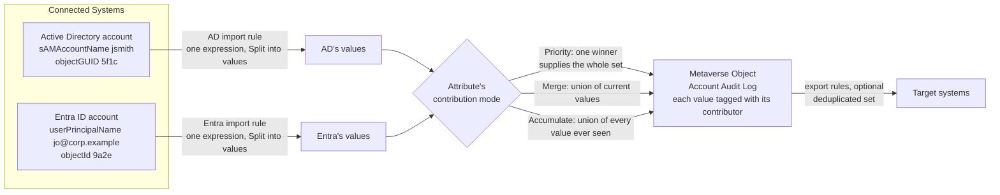
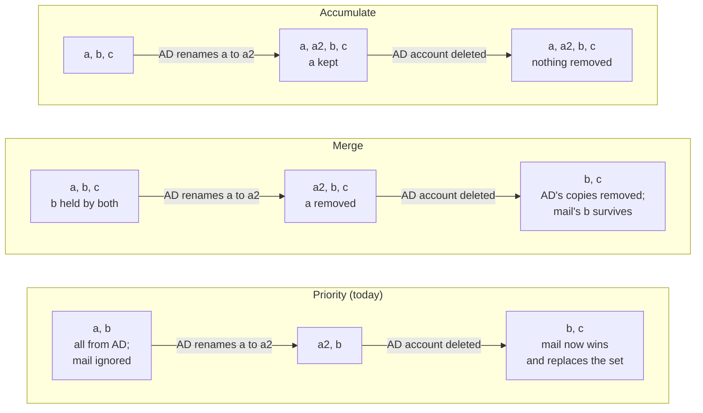
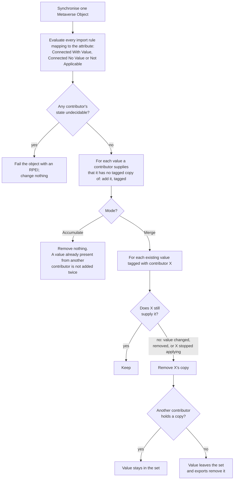
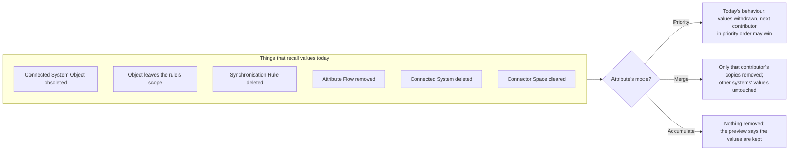
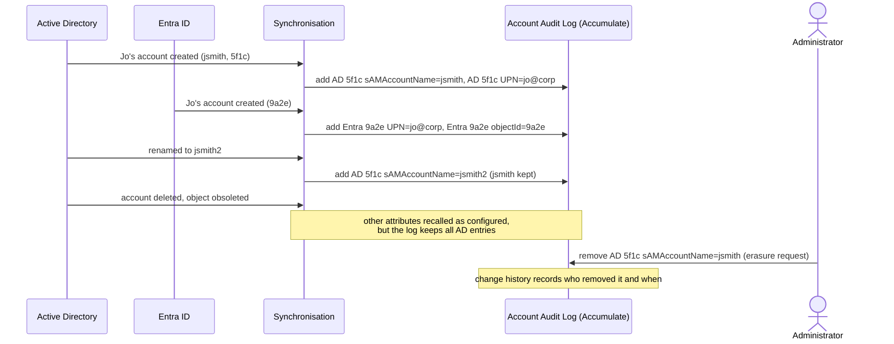
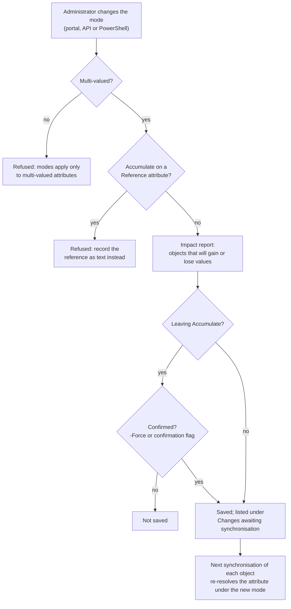

# Contribution Modes for Multi-Valued Metaverse Attributes (Merge and Accumulate)

- **Status:** Doing (Phase 1 underway)
- **Created:** 2026-11-23
- **Author:** JayVDZ (drafted via Claude Code)
- **Issue:** [#3059](https://github.com/TetronIO/JIM/issues/3059)

## Problem Statement

A multi-valued Metaverse attribute takes its values from exactly one Synchronisation Rule at a time. Attribute Priority resolution picks the first applicable contributor in priority order, and that contributor supplies the **entire value set**; every lower-priority contributor is ignored (`AttributePriorityService`, `ContributionState.ConnectedWithValue`). There is no way for two Connected Systems to add values to the same multi-valued attribute side by side.

Two scenarios are blocked by this:

1. **An audit log of every account a person has been issued.** An administrator wants one multi-valued attribute (for example "Account Audit Log") that records the unique identifiers of each account a person has held, in every Connected System (sAMAccountName, objectGUID, objectSid, userPrincipalName from Active Directory; the equivalents from Entra ID and others), and **keeps them after the accounts are deleted**. Today this fails twice over:
   - Only one system can contribute, so Active Directory and Entra ID cannot both write into the log.
   - When the Active Directory account is deleted, its Connected System Object is obsoleted and its contributed values are recalled (unless `RemoveContributedAttributesOnObsoletion` is turned off for the whole Connected System object type, which keeps *every* attribute that object type contributes, not just the log). And even with recall off, the next contributor in priority order would win and replace the whole set at the next synchronisation.
2. **A combined set kept in step with several sources.** An administrator wants a multi-valued attribute (for example "Email Addresses", or a set of external identifiers) built from the values of several Connected Systems, where a value removed in one source is removed from the Metaverse and every other source's values are left alone.

The storage already supports both: each `MetaverseObjectAttributeValue` row records the Synchronisation Rule that contributed it (`ContributedBySyncRuleId`, with `ContributedBySystemId` retained if the rule is deleted), and a Metaverse Object has at most one Connected System Object per Connected System, so the contributing rule identifies the source account. What is missing is resolution logic that combines contributions instead of picking one winner.

## Goals

- An administrator can set a multi-valued Metaverse attribute's **contribution mode** to **Priority** (today's behaviour, the default), **Merge** or **Accumulate**.
- In **Merge** mode, every applicable contributor adds its values, and a value one contributor stops supplying is removed without touching values other contributors supply.
- In **Accumulate** mode, every contributor adds its values and synchronisation never removes them: not on a value change, scope exit, disconnection, obsoletion, or deletion of the Synchronisation Rule, Attribute Flow or Connected System.
- An administrator can remove individual entries from an Accumulate attribute by hand (for example to honour a right-to-erasure request), with the removal recorded in change history.
- Existing configurations behave exactly as before: every attribute starts in Priority mode, and no upgrade changes a resolved value.
- The capability ships across the portal, the REST API and PowerShell together.

## Non-Goals

- A per-Attribute Flow recall setting (keep or recall a flow's values when its source object leaves). It is tracked separately as #3064, which covers single-valued attributes that Accumulate cannot; this PRD only fixes how the two interact (see Precedence with recall settings).
- Changing `RemoveContributedAttributesOnObsoletion` or Priority mode behaviour.
- Contribution modes for single-valued attributes.
- Keeping an Accumulate attribute after its Metaverse Object is deleted. The Metaverse Object's deletion record already keeps its last values for the history retention period; long-term retention beyond that is out of scope.
- General editing of Metaverse Object values (that is #614). Only removing an Accumulate entry is in scope.
- Accumulate mode for Reference attributes (see Constraints).

## User Stories

1. As an identity administrator, I want an "Account Audit Log" attribute that every Connected System adds its account identifiers to and that keeps them after the accounts are deleted, so that I can answer "which accounts has this person ever had?" years later.
2. As an identity administrator, I want a multi-valued attribute built from several Connected Systems that stays in step with each of them, so that a value removed in one source disappears without losing the others.
3. As a data protection officer, I want to remove specific entries from an accumulated attribute and see who removed them and when, so that JIM can honour erasure requests.
4. As an administrator changing an attribute's contribution mode, I want to see which values the change will add or remove before it takes effect, so that switching modes never silently loses data.

## Data Flows

### End to end: from accounts to the Metaverse and out again

Each Connected System's import rule produces that system's values for the attribute. The attribute's contribution mode decides how those per-system value sets become the Metaverse Object's value set. Every value keeps a tag naming the Synchronisation Rule that contributed it; exports send the set with duplicates removed.



### The three modes given the same events

Active Directory (priority 1) supplies `a` and `b`; the mail system (priority 2) supplies `b` and `c`. Then Active Directory renames `a` to `a2`, and later the Active Directory account is deleted.



### What one synchronisation does to each value

How the engine decides, for one Metaverse Object and one attribute, which values to add and which to remove. Priority mode is unchanged and not shown.



### Recall paths

Every path that recalls a contributor's values today first checks the attribute's mode.



### An account audit log over time

Scenarios 1, 2, 3 and 6 in sequence.



### Changing an attribute's mode



## Requirements

### Functional Requirements

**Configuration**

1. Each multi-valued Metaverse attribute has a contribution mode: Priority (default), Merge or Accumulate. Single-valued attributes have no mode; the portal does not offer one and the API and PowerShell reject one.
2. Accumulate is not available for Reference attributes (see Constraints for why); the refusal message points to recording the reference as text instead. Merge is not available for Reference attributes either, at first (resolved Question 5); allowing it later is additive.
3. In Merge and Accumulate modes, the priority order for that attribute is not used. The portal shows the contributors without an order and says why; the priority endpoints and cmdlets report the mode, and reordering them is refused with a message that names the mode.
4. In Merge and Accumulate modes, "Null is a value" has no effect on mappings to that attribute. The Attribute Flow editor disables it with an explanation, and saving a mapping with it set is accepted but recorded as having no effect (no error, so existing mappings keep saving).

**Merge resolution**

5. The resolved value set is the union of the values supplied by every contributor whose state is Connected With Value. Each value records one contributing Synchronisation Rule (resolved Question 2).
6. When two contributors supply the same value, it appears once in the resolved set, on the portal, in the API and in exports. It is removed only when no contributor still supplies it. Values are compared exactly, so `Jo@corp.example` and `jo@corp.example` are two values; an administrator who wants them treated as one sets the mapping's inbound case normalisation.
7. When a contributor stops supplying a value (the source value changed or was removed), the value is removed only if no other contributor supplies it. If another does, the value stays and is recorded against that contributor instead.
8. When a contributor stops applying (out of scope, disconnected, rule disabled, Connected System Object obsoleted), its values are removed, following the same rules as recall today: `RemoveContributedAttributesOnObsoletion` turned off on the object type keeps them on obsoletion, and the grace-period freeze (#1570) still applies.
9. Every recall path removes only the recalled contributor's values in a Merge attribute: Synchronisation Rule deletion, Attribute Flow removal, Connected System deletion, Connector Space clearing, stranded-value sweeps and contributor re-election.

**Accumulate resolution**

10. Every value a contributor supplies is added to the set and kept, with its contributor recorded, even after that contributor stops supplying it.
11. None of the recall paths in requirement 9, nor obsoletion, scope exit or disconnection, removes an Accumulate value. Previews of those actions (Synchronisation Rule deletion, Attribute Flow removal, Connected System deletion, Connector Space clearing) say that the attribute's values will be kept.
12. A value already in the set is not added a second time when a later contributor supplies it; the set holds each distinct value once, keeping the first contributor recorded. Values are compared exactly, as in requirement 6.
13. If a Synchronisation Rule that contributed Accumulate values is deleted, the values stay and keep their recorded Connected System (`ContributedBySystemId`), as provenance does today.

**Precedence with recall settings**

When a contributor's source object leaves, whether its values are kept is decided by the most specific setting, in this order:

- **First:** the attribute's mode is Accumulate. The values are always kept, whatever the settings below say.
- **Then:** the Attribute Flow's own recall setting (Recall or Keep), once #3064 adds it.
- **Otherwise:** the Connected System object type's `RemoveContributedAttributesOnObsoletion`.

Accumulate is therefore an exception to recall that is configured on the Metaverse attribute, not on the Connected System. It also covers removals the object type setting never controlled: value changes in a live account, and withdrawal by Synchronisation Rule deletion, Attribute Flow removal, Connected System deletion and Connector Space clearing.

**Manual removal (Accumulate only)**

14. An administrator can remove one or more entries from an Accumulate attribute on a Metaverse Object, from the portal, the REST API and PowerShell. The removal is recorded in the object's change history as a person's change (`ValueContributorKind.Person`), with who and when, and on an Activity.
15. Removing an entry that a live contributor still supplies is refused with a message that names the contributor, because the next synchronisation would add it back (resolved Question 3).

**Changing mode**

16. Changing an attribute's mode is a configuration change that takes effect at the next synchronisation of the affected objects, like a priority change today, and appears under Changes awaiting synchronisation.
17. Before the change is saved, the portal, API and PowerShell report its impact: how many Metaverse Objects will gain or lose values. Changing from Accumulate to any other mode, which would remove values no live contributor supplies, requires explicit confirmation (`-Force` in PowerShell, a confirmation flag in the API).

**Visibility**

18. The portal's Metaverse Object view, the provenance endpoint and `Get-JIMMetaverseObjectProvenance` show the recorded contributor of each value in a Merge or Accumulate attribute, including Accumulate values whose contributor no longer supplies them. One contributor is recorded per value; where several supply it, the others are not stored (resolved Question 2).
19. Sync Preview, Full Synchronisation preview, change history and Activities record each value added or removed with its contributor, as they do for value changes today.
20. The Data Flow view's Multiple contributors filter shows the mode of each attribute it lists.

**Export**

21. Export Attribute Flows send the resolved, deduplicated set. Saving an export flow that maps an Accumulate attribute shows an advisory that every accumulated value, including those from deleted accounts, will be exported.

### Non-Functional Requirements

- **Synchronisation integrity:** a Merge or Accumulate resolution that cannot determine a contributor's values (for example an undecidable scoping criterion, #2336) fails that object with an RPEI rather than removing values.
- **Performance:** resolution must not add a per-value database round trip. A full synchronisation of 100,000 Metaverse Objects with a Merge attribute fed by three systems must run within 10% of the same run in Priority mode.
- **Growth:** an Accumulate attribute grows without bound by design. The portal and API must remain usable with at least 500 values on one object's attribute (resolved Question 4: no hard cap).
- **Upgrade:** additive only. A new mode column defaults to Priority; no existing value changes on upgrade.

## Examples and Scenarios

### Scenario 1: Account audit log across two systems

**Given**: "Account Audit Log" is a multi-valued text attribute in Accumulate mode. The Active Directory import rule maps
`Split("AD|" + cs["objectGUID"] + "|sAMAccountName=" + cs["sAMAccountName"] + ";AD|" + cs["objectGUID"] + "|userPrincipalName=" + cs["userPrincipalName"], ";")`
and the Entra ID import rule maps a similar expression prefixed `Entra|`.
**When**: Jo is synchronised from both systems.
**Then**: the attribute holds all four entries, two contributed by each rule.

```
Account Audit Log (Accumulate)
  AD|5f1c…|sAMAccountName=jsmith           Active Directory Users
  AD|5f1c…|userPrincipalName=jo@corp.example  Active Directory Users
  Entra|9a2e…|userPrincipalName=jo@corp.example  Entra ID Users
  Entra|9a2e…|objectId=9a2e…               Entra ID Users
```

### Scenario 2: Account deleted in Active Directory

**Given**: Scenario 1, and Jo's Metaverse Object deletion rule keeps the object while any connector remains.
**When**: Jo's Active Directory account is deleted, imported and synchronised.
**Then**: the Connected System Object is obsoleted and its other contributed attributes are recalled as configured, but both `AD|` entries stay in Account Audit Log, still showing Active Directory Users as their contributor.

### Scenario 3: Rename in Accumulate mode

**Given**: Scenario 1.
**When**: Jo's sAMAccountName is renamed to `jsmith2`.
**Then**: `AD|5f1c…|sAMAccountName=jsmith2` is added and `AD|5f1c…|sAMAccountName=jsmith` is kept.

### Scenario 4: Merge keeps sources in step

**Given**: "Email Addresses" in Merge mode, fed by Active Directory (`a@corp.example`, `b@corp.example`) and the mail system (`b@corp.example`, `c@corp.example`).
**When**: `b@corp.example` is removed in Active Directory, then later `a@corp.example` is removed too.
**Then**: after the first change the set is still `a`, `b`, `c` (the mail system still supplies `b`); after the second it is `b`, `c`.

### Scenario 5: Merge contributor leaves

**Given**: Scenario 4's starting state, with recall on obsoletion turned on.
**When**: the person's mail system object is deleted.
**Then**: the set becomes `a`, `b`: `c` is removed and `b` is kept because Active Directory still supplies it.

### Scenario 6: Erasure request

**Given**: Scenario 2.
**When**: an administrator runs `Remove-JIMMetaverseObjectAttributeValue -MetaverseObjectId <id> -AttributeName 'Account Audit Log' -Value 'AD|5f1c…|sAMAccountName=jsmith'`.
**Then**: the entry is removed, and the change history shows it removed by that administrator, at that time.

### Scenario 7: Switching away from Accumulate

**Given**: Account Audit Log holds entries from deleted accounts on 1,200 objects.
**When**: an administrator changes the mode to Merge.
**Then**: the impact report says 1,200 objects will lose values no live contributor supplies, and the change is not saved without confirmation.

### Scenario 8: Single-valued attribute

**When**: an administrator sets the mode of the single-valued "Display Name" attribute to Merge through the API.
**Then**: the request is rejected with a 400 that says contribution modes apply only to multi-valued attributes.

### Scenario 9: Auditing references as text

**Given**: an administrator wants a history of every manager Jo has had.
**When**: they set the multi-valued Reference attribute "Managers" to Accumulate.
**Then**: the change is refused, and the message suggests recording the reference as text instead.
**When**: they create a multi-valued text attribute "Manager History" in Accumulate mode, fed by the Active Directory rule with `"AD|manager=" + cs["manager"]`.
**Then**: each manager's distinguished name is added as Jo's manager changes, and every entry stays after that manager's Metaverse Object is deleted.

## Constraints

- Additive under semantic versioning: new optional fields and parameters only; the default reproduces today's behaviour exactly.
- Accumulate is not allowed for Reference attributes, for two reasons:
  - **A reference cannot outlive its target.** A Reference value is only a pointer to another Metaverse Object. When that object is deleted, JIM deletes the pointing rows from every surviving object rather than nulling them, because a nulled row carries no information (#1019, `MetaverseObjectAttributeValue.IsValuelessReferenceRow`). An accumulated reference would therefore be removed anyway, breaking Accumulate's guarantee.
  - **It makes revoking access fail silently.** The common multi-valued Reference attribute is a group's Members. Accumulate on Members, combined with an export flow, would keep sending removed people back into the group, so their access would never be revoked.

  An audit of references wants a snapshot that survives the referenced object, which a text attribute provides: an Accumulate text attribute fed by an expression that records the source's own identifier for the reference (for example `"manager=" + cs["manager"]`, the manager's distinguished name in Active Directory). Scenario 9 covers this.
- Synchronisation integrity rules in `src/JIM.Application/CLAUDE.md` apply: no silent value loss, every failure reported through RPEIs and Activities.
- No new third-party dependencies.

## Affected Areas

| Area | Impact |
|------|--------|
| Models | New `AttributeContributionMode` enum; `ContributionMode` column on `MetaverseAttribute` (resolved Question 1) |
| Database | Migration adding the mode column, default Priority; possibly an index supporting per-contributor value lookup |
| Application | `AttributePriorityService` gains Merge and Accumulate resolution; the sync engine's attribute flow persistence computes per-contributor diffs; every recall path (obsoletion, scope exit, Synchronisation Rule deletion recall, Attribute Flow removal, Connected System deletion, Connector Space clear, stranded-value sweep, `ContributorReElectionService`) honours the mode; manual removal server method |
| Worker | Resolution runs inside existing synchronisation processors; no new task types expected beyond the mode-change impact report if it must run asynchronously |
| Export | Export evaluation sends the deduplicated set |
| API | Mode on the Metaverse attribute or priority DTOs; impact-report endpoint; value-removal endpoint |
| PowerShell | Mode parameter on `Set-JIMMetaverseAttribute` (or the priority cmdlets); output shapes updated; new `Remove-JIMMetaverseObjectAttributeValue` |
| UI | Mode selector and impact confirmation on the Attribute Priority configuration; Attribute Flow editor disables Null is a value; per-value contributor and remove action on the Metaverse Object view; export flow advisory |
| Tests | Unit tests for resolution and every recall path; database tests for persistence; an integration scenario covering Scenarios 1 to 5 |

## Documentation Impact

| Doc | Change |
|------|--------|
| `docs/concepts/attribute-priority.md` | New section on contribution modes, and the resolution diagram's scope stated as Priority mode |
| `docs/concepts/expression-recipes.md` | Account audit log recipe using `Split`, and recording references as text for an Accumulate history |
| `docs/configuration/deleted-objects.md` | How Accumulate values relate to deletion records and retention |
| `docs/configuration/` Metaverse attribute and object pages | Mode setting, impact report, manual removal |
| `docs/powershell/` metaverse pages | New and changed parameters, output shapes, the new cmdlet |
| `docs/api/index.md` | New fields and endpoints |
| `engineering/DEVELOPER_GUIDE.md` | Resolution and recall architecture where it describes attribute priority |

## Dependencies

- None blocking. #614 (Internal MVO Management) would provide general value editing; this PRD needs only removal from an Accumulate attribute and should not wait for it (resolved Question 3).

## Resolved Questions

Resolved while writing the implementation plan ([`MULTI_VALUED_CONTRIBUTION_MODES.md`](../../plans/doing/MULTI_VALUED_CONTRIBUTION_MODES.md)), which gives the code evidence for each.

1. **Where the mode lives: one mode per Metaverse attribute.** Priority is not stored per Metaverse attribute and Metaverse Object Type, as this PRD first assumed; it is stored on each import mapping, and the order is computed from them. The link between an object type and its attributes holds no data, so a per-type mode would mean turning that link into an entity of its own. The mode is a column on `MetaverseAttribute`, the same on every object type that uses the attribute. An administrator who wants Accumulate on Person and Priority on Group creates two attributes.
2. **Duplicate values in Merge: one row per distinct value, recording one contributor.** Export assumes each value is held in one row. With a row per contributor, a value one source dropped while another still held it would be removed at the target, and a new object would be sent the value twice. Instead, when the recorded contributor stops supplying a value, the value is recorded against another contributor that still supplies it, or removed if none does.
3. **Removing an entry a live contributor still supplies: refused.** No suppression list.
4. **A cap on Accumulate growth: none.** The Metaverse Object view pages an attribute's values. A warning threshold waits until a customer reports a real size.
5. **Merge for Reference attributes: refused at first.** References already have their own recall and deletion rules (#1019), and no current scenario needs Merge on them. Allowing it later is additive.

## Acceptance Criteria

- [ ] A multi-valued attribute's mode can be set and read in the portal, REST API and PowerShell; single-valued attributes and Reference attributes in Accumulate are refused.
- [ ] Scenarios 1 to 9 behave as described, covered by unit tests and an integration scenario.
- [ ] Every recall path listed in requirement 9 is tested in Merge and Accumulate modes.
- [ ] Upgrading an existing database changes no resolved value; existing tests pass unchanged.
- [ ] Mode changes show an impact report, and leaving Accumulate needs confirmation.
- [ ] Manual removal works on all three surfaces and is recorded in change history and on an Activity.
- [ ] Sync Preview, change history and provenance show each value's contributor.
- [ ] The performance target in Non-Functional Requirements is met at 100,000 objects.
- [ ] Documentation listed above is updated in the same PR.

## Additional Context

- Attribute priority resolution: #91, `src/JIM.Application/Services/AttributePriorityService.cs`, `docs/concepts/attribute-priority.md`.
- Value provenance and recall: #1292, #1533, #1537, #1549, #1570, #2336, #2472.
- One Connected System Object per Connected System per Metaverse Object: `docs/administration/troubleshooting-synchronisation.md`.
- Recall on obsoletion today is per Connected System object type: `ConnectedSystemObjectType.RemoveContributedAttributesOnObsoletion`.
